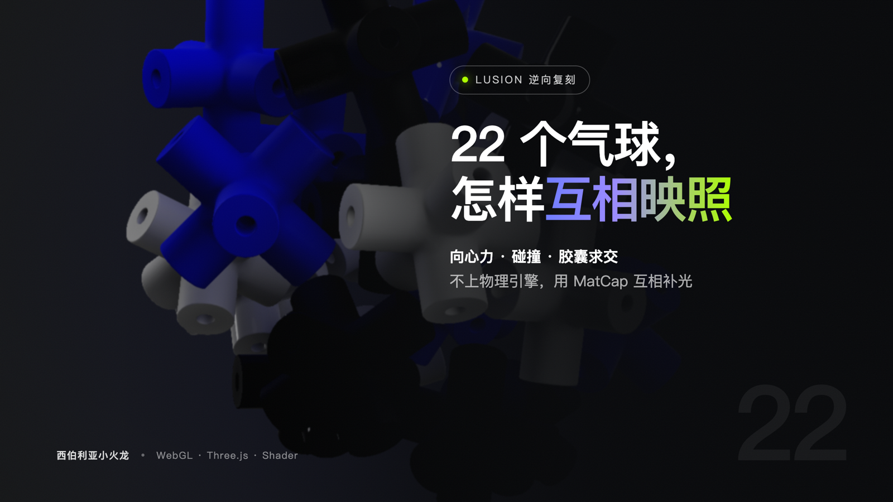
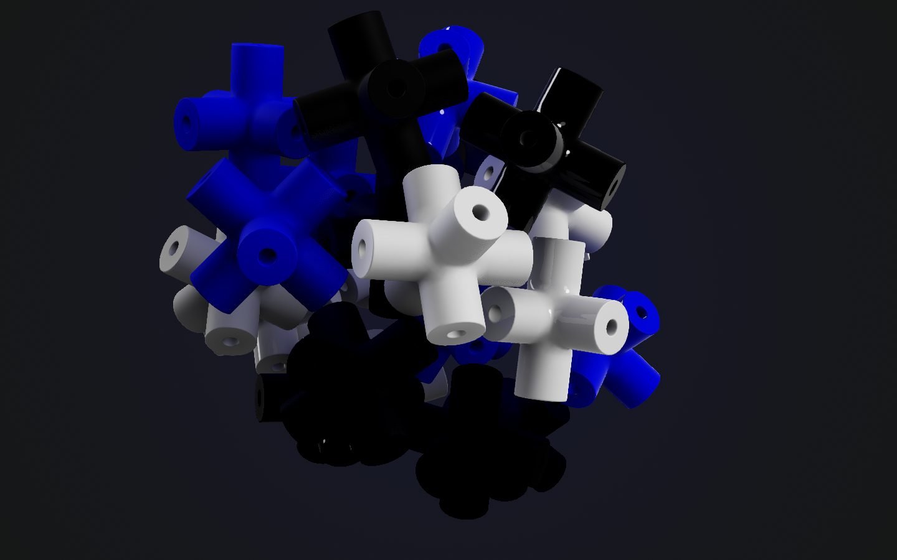
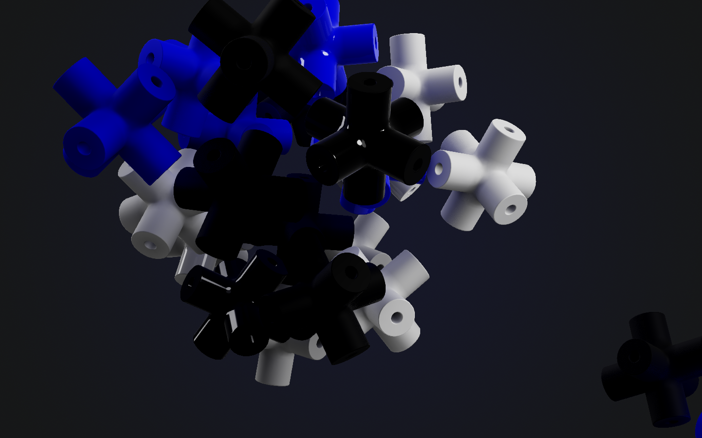
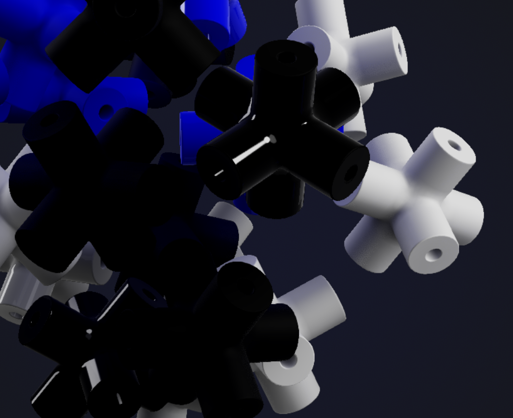
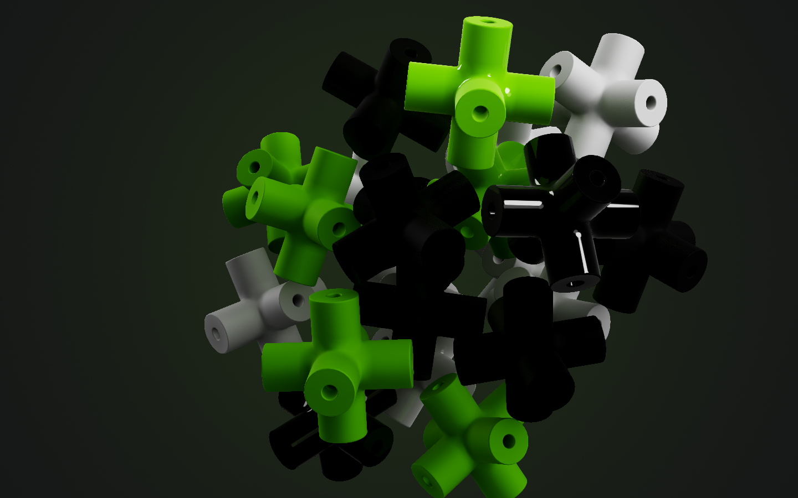

# 22 个气球，怎样互相映照：拆解 Lusion 主页的气球特效



> 本文配套源码就是这个仓库，`npm install && npm run dev` 即可运行。

## 前言

这里是西伯利亚小火龙。

上一次我拆了 Lusion 的屏幕流体特效（就是那个「我以为是流体解算，结果只是一张贴图」的障眼法），这次把目光挪到他们的主页：一坨气球悬在那儿，鼠标划过去，球被轻轻推开；手一松，它们又慢悠悠地飘回中心，互相之间还会映出彼此的颜色。最要命的是——两个球靠得近的时候，接触的那一圈会「软」下来，颜色往对方身上渗，像真的橡胶气球一样。

先上截图：





说实话，我第一反应是：这玩意儿肯定上了软阴影 + 屏幕空间反射 + 某种距离场烘焙。结果 F12 一看源码，好家伙，人家把一个气球当成「三根正交的胶囊」，AO、阴影、反射全是拿这三根胶囊算的，从头到尾没有一张 ShadowMap，没有一次 ray marching。

那就有意思了。这篇文章就把这套「胶囊障眼法」拆开，用 Three.js 从头写一遍。

## 先看看它到底长什么样

静止的时候，就是 22 个球围成一坨浮在画面中央。颜色很克制：6 个彩色球（蓝），8 个白球，8 个近黑球，大小一样，混在一起。



看着平平无奇对吧？但注意看球和球交界的地方：白球会映出旁边蓝球的一点蓝，彩色球上又有一层别的球蹭上去的暗影。这种「互相映照」不是贴图，是每颗球实时盯着其余 21 颗球算出来的。

点一下画面，配色整体换一茬，球簇还会「炸」一下再重新聚拢：



## 拆一下原理

整个效果分两大块，我画个图：

```
鼠标事件
   │
   ▼
① 物理系统（JS 侧，每帧固定步长）
   │  向心重力 + 强阻尼 + 两两碰撞 + 鼠标推挤
   │  → 22 个球的位置 / 朝向
   ▼
② 每帧给每个球重新找最近的 21 个邻居
   │
   ▼
③ 顶点/片元着色器（GPU 侧）
   │  顶点：烘焙 AO → 自阴影
   │  片元：对 21 个邻居做「十字胶囊」求交
   │        → AO / 阴影 / GI / 反射
   │        → matcap 上色 → filmic 色调映射
   ▼
屏幕
```

抓住两个点就行。

**物理是「软」的**。没有用任何刚体引擎，就是自己手写的一坨显式欧拉积分：重力指向原点，速度每帧疯狂衰减，球和球之间做一维弹性碰撞。22 个球，22² 次碰撞判定，纯 JS 跑 60 帧毫无压力。

**渲染的「互相映照」是拿胶囊算的**。每颗球的片元着色器里，要把 21 个邻居各当成三根正交的胶囊，分别求 AO、阴影和反射。你没有看错——一个球 = 三根胶囊，三根胶囊拼起来就「约等于」一个球。

想明白这两点，剩下的都是体力活。

## 用到的库

还是那句话，正经用到的库就一个：

- Three.js

没有物理引擎，没有 ECS，后处理也是自己接的（SMAA / FSR / Final 收尾）。工程外壳是 Vite + 原生 JS，没上框架，代码拷到哪儿都能跑。

## 先把 22 个气球造出来

在 `lusionData.js` 里，22 个球的配置是写死的一张表：

```js
const RAW = [
  { color: 'fancy',   isRough: true  },
  { color: 'fancy',   isRough: true  },
  { color: 'fancy',   isRough: false },
  { color: '#ffffff', isRough: true  },
  // ... 共 22 个
];
```

其中 `fancy` 是占位符，会被替换成当前主题色。5 套主题色轮着来：

```js
export const BALLOON_COLORS = [
  '#061dfb', // 蓝
  '#ADFF00', // 荧光绿
  '#f6000e', // 红
  '#7e09f5', // 紫
  '#ffc000', // 橙
];
```

`makeSphereData(fancyHex)` 把这张表展开成完整配置，补齐物理参数。有意思的是，四种材质预设的物理参数**完全相同**：

```js
const PRESET = { density: 1, friction: 2, restitution: 0.8 };
```

密度都是 1，摩擦都是 2，弹性都是 0.8。也就是说 22 个球物理上是一模一样的，唯一的区别只有颜色和「粗糙 / 光滑」这个材质开关。`isRough` 决定了后面 matcap 用哪个通道做高光，先记着，后面会讲到。

## 物理部分：让气球「活」起来

物理全部在 `HomeBalloonsPhysics.js` 里，加上一个 `HomeBalloonsBody` 类代表单颗球。

### 初始分布：一场「向心汇聚」

每个球的初始位置和初速度不是乱滚，而是算好的：

```js
this.position0 = new THREE.Vector3(
  (rand() - 0.5) * 12,
  (rand() - 0.5) * 12,
  (rand() - 0.5) * 6
);
// 初速度 = 位置 × -2：指向原点，且越远的球越快
this.velocity0 = this.position0.clone().multiplyScalar(-2);
```

看到没，初速度是位置的负两倍。于是开场那一瞬间，所有球从四面八方「射向」原点，撞成一团，再被阻尼慢慢稳住。这个「开局一撞」本身就是 Lusion 主页加载动画的雏形。

这里的随机数是可复现的：字符串种子 `'balloonBody-25'` 先过一遍 FNV-1a，再进 mulberry32。刷新多少次，22 个球都落在完全相同的位置，方便截图对比。

### 重力 + 强阻尼：气球「飘」的秘密

每帧第一步是更新重力：

```js
updateGravity(dt) {
  // 重力指向原点、大小与距离成正比（弹簧式向心力）
  this.gravityAcc.copy(this.position).negate().multiplyScalar(GRAVITY_FACTOR);
  this.gravityAcc.multiplyScalar(1 / this.mass);
  // 碰撞摩擦会削弱重力（接触越多越"粘"）
  this.gravityAcc.multiplyScalar(1 / (1 + this.frictionTot));
  this.velocity.addScaledVector(this.gravityAcc, dt);
  this.frictionTot *= 0.5;
}
```

`GRAVITY_FACTOR = 40`，重力大小跟到原点的距离成正比，像一根弹簧把球往回拽。接着是关键的阻尼：

```js
integrate(dt) {
  this.position.addScaledVector(this.velocity, dt);
  // 强阻尼：dt=1s 时只剩 20%
  this.velocity.multiplyScalar(Math.pow(0.2, dt));
}
```

`Math.pow(0.2, dt)`——这一步是这个效果「手感」的灵魂。一秒钟后速度只剩 20%，两秒只剩 4%。所以球被推开后不会像台球一样永远滚下去，而是很快「泄气」漂回中心。想调「飘多久」，调这个 0.2 就完事。

### 两两碰撞：一维弹性碰撞

22 个球，两两配对是 C(22,2) = 231 对，直接全遍历。每对球重叠了就沿法线分离，然后做一次一维弹性碰撞：

```js
const frictionAvg = Math.sqrt(body.friction * other.friction);
body.frictionTot += frictionAvg;
other.frictionTot += frictionAvg;

// 一维弹性碰撞：A 沿法线的新速度
const newA = (mA * velA + mB * velB - mB * (velA - velB) * rA) / (mA + mB);
const newB = (mA * velA + mB * velB - mA * (velB - velA) * rB) / (mA + mB);

_vel.addScaledVector(_normal, (newA - velA) / (1 + frictionAvg));
_velB.addScaledVector(_normal, (newB - velB) / (1 + frictionAvg));
```

注意 `frictionTot` 是**几何平均**，碰撞越频繁它越大，进而削弱重力——球挨得越紧就越「粘」，这就是一坨气球挤在一起时那种「软塌塌」的质感的来源。

质量、转动惯量都是老老实实算的：

```js
this.volume = Math.PI * this.radius * 1.333333;
this.mass = this.volume * this.radius * this.radius * this.density;
this.inertia = this.mass * this.radius * this.radius * 0.4;
```

物理半径是 `BODY_RADIUS_SCALE = 1.05` 倍，比视觉半径略大一点，球还没完全贴上就「撞」了，避免出现两个球边缘穿模的尴尬。

### 鼠标推挤：不是球，是一条「射线管」

这是整套交互里最精妙的一步。鼠标在屏幕上只是一个点，但代码把它当成一根从相机出发、穿过屏幕点的**射线管**：

```js
// 把 NDC 反投影成世界射线，再求与 z=0 平面的交点
_mousePlane.set(mouseXY.x, mouseXY.y, 0.5).unproject(camera);
_mousePlane.sub(camera.position).normalize();
const t = (0 - camera.position.z) / _mousePlane.z;
_mouse.copy(camera.position).add(_mousePlane.multiplyScalar(t));
```

然后把每颗球投影到「相机 → 鼠标」这条射线上，算球心到投影点的距离，减去球半径和鼠标半径：

```js
_v0.copy(_pos).sub(camera.position);
let c = _v0.dot(_mouseBA) / mouseBALenSq;
c = _v0.sub(_velB.copy(_mouseBA).multiplyScalar(c)).length()
    - body.radius - MOUSE_RADIUS; // MOUSE_RADIUS = 0.025
```

`c < 0` 说明球和这条射线管相交了，球被「戳中」了。这时不是简单往外推，而是算一个垂直于射线的分离方向：

```js
_v0.copy(_pos).sub(camera.position).cross(_mouseBA).normalize();
_v1.copy(_mouseBA).cross(_v0).normalize();
_pos.sub(_v1.multiplyScalar(MOUSE_INFLUENCE * c));   // 推开
_v1.multiplyScalar(-MOUSE_PUSH_FORCE / dt);
_vel.add(_v1);                                        // 加推力
_vel.add(_mousePushForce);                            // 叠加鼠标速度，把球甩出去
```

`_mousePushForce` 是鼠标本帧的移动速度换算来的，所以快速甩鼠标，球会被「甩」出去；慢慢挪，球只是被轻轻拨开。这个「射线管 + 投影 + 甩出」的组合，就是手感好的全部秘密。

### 旋转：位置 × 速度 = 角动量

球的朝向也用物理驱动。角动量方向近似等于 `位置 × 速度`：

```js
_v0.crossVectors(_pos, _vel);
let spin = _v0.length() / body.inertia;
if (spin > 0) {
  _v0.normalize();
  _quat.setFromAxisAngle(_v0, spin * dt);
  body.quaternion.premultiply(_quat);  // 左乘，世界空间叠加
}
```

旋转很重要——后面着色器里烘焙的 AO 是跟着球一起转的，球不转，那层「自阴影」就死板得像贴上去的。

### 固定步长：60 帧的尊严

最后一点工程细节。物理是显式欧拉，对时间步长敏感，所以不直接用真实 `dt`，而是累积到固定步长再跑：

```js
const STEP = 1 / 60;
while (this._acc >= STEP && steps < 4) {
  this.physics.update(STEP, this.camera, mouseXY);
  this._acc -= STEP;
  steps++;
}
```

不管显示器是 144Hz 还是切后台回来卡了几百毫秒，物理始终按 1/60 秒一步推进，最多追 4 步就放弃，避免「追帧雪崩」。

## 渲染部分：22 个球互相映照

物理只是让球动起来，真正让人「哇」的是着色器。这块在 `balloon.js` 里，是整个项目最硬核的部分。

### 每个球带 21 个邻居的 uniform

每颗球一个独立的 `ShaderMaterial`，uniform 里塞着 21 个邻居的四组数组：

```js
u_nearPositionRadiusList  // vec4 × 21：位置 + 半径
u_nearRotationList        // vec4 × 21：四元数
u_nearColorList           // vec3 × 21：颜色
u_nearTransparencyLumaList// vec2 × 21：半透明 + 亮度
```

这些数组每帧在 `_updateSorting()` 里重算：为每颗球求它到其它 21 颗球的**距离平方**，排序取前 21 个。为什么用距离平方？因为排序只需要相对大小，省掉 21 次开方，白捡的性能。

### 十字胶囊：一个球 = 三根胶囊

这是全文最反直觉的地方。真实的球体求交（AO、阴影、反射）在片元里太贵，Lusion 的办法是把一个球近似成三根**互相垂直的胶囊**，每根胶囊半长 `R = 2/3 * 半径`，粗细 `r = 1/3 * 半径`：

```glsl
float R = 0.666667 * objPosRadius.w;
float r = 0.333333 * objPosRadius.w;
```

三根胶囊拼起来，看着像个「十字」——所以函数名叫 `getCrossAoShadowIntersect`。它一次返回三个值：

```glsl
// 返回 vec3：x = AO，y = 阴影，z = 反射最近命中距离
```

先做 **AO**。把着色点分别投影到 X / Y / Z 三根胶囊上，用 IQ 那套球体 AO 公式推广到三轴：

```glsl
vec3 o3 = vec3(1.) - saturate(
  vec3(dot(-odX, n), dot(-odY, n), dot(-odZ, n))
  * r * r / (dl3 * dl3 * dl3)
);
o3 = sqrt(o3 * o3 * o3);
ao = o3.x * o3.y * o3.z;
```

再做 **阴影**。光方向同样在三根胶囊上求交点，得到有符号距离后套个 `smoothstep` 式的软化：

```glsl
vec3 s = saturate(k * dd / thX3 + 0.5);
s = s * s * (3.0 - 2.0 * s);
shadow = s.x * s.y * s.z;
```

### 反射：沿反射方向打三根圆柱

最「唬人」的部分来了——气球互相映照。对每个邻居，把反射方向打进邻居本地空间，然后对三根圆柱求交，取最近命中：

```glsl
if (centerSphereHitTest(ro, refl, objPosRadius.w * 1.1)) {
  // X 轴圆柱
  a = vec3(-objPosRadius.w, 0.0, 0.0);
  b = vec3( objPosRadius.w, 0.0, 0.0);
  intersect = min(intersect, cylIntersect(p, refl, a, b, r));
  // Y 轴、Z 轴同理……
}
```

`cylIntersect` 是标准的光线-圆柱求交，二次方程解出最近交点。注意那个提前剔除 `centerSphereHitTest`：先粗判反射射线有没有打中邻居的包围球，没打中直接跳过，省掉后面三个圆柱求交。这层「粗筛 + 精算」的组合，是它能实时跑满 60 帧的关键。

一个像素 × 21 个邻居 × 3 根圆柱 = 63 次圆柱求交，还叠加了 AO 和阴影。说实话这 shader 挺重的，但换来的是「每一颗球都在实时映照其它球」的观感，值。

### 反射结果怎么用

遍历完 21 个邻居，拿到最近的反射颜色，按距离衰减：

```glsl
reflections.rgb *= 1. / ((0.2 + roughness * 0.8) * reflections.w * 10. + 4.);
reflections = reflections * ao * v_ao;
```

越粗糙的球，反射衰减越快（`roughness` 乘在分母上），光滑球则能清晰映出邻居。这就是为什么有些球像镜子、有些球是哑光的。

### matcap：一张贴图干了三件事

高光和漫反射不靠真正的光照，靠一张 matcap。这张 EXR 的三个通道分工明确：

| 通道 | 作用 |
| --- | --- |
| R | 漫反射 |
| G | 粗糙高光 |
| B | 光滑高光 |

```glsl
vec3 matcapMap = texture2D(u_matcap, uvPerturbed).rgb;
vec3 matcapDiff = vec3(matcapMap.r);
vec3 matcapSpec = vec3(roughness > .5 ? matcapMap.g : matcapMap.b);
```

`isRough` 在 JS 侧只决定 `u_roughness` 是 0.8 还是 0.1，然后这里一个三元运算就选了高光通道。粗糙球用 G，光滑球用 B，一张贴图伺候两种材质。

顺带一提，粗糙度还在片元里动态加成了一点：

```glsl
float roughness = min(0.9, u_roughness + dot(vec3(1.0), fwidth(viewNormal)));
```

`fwidth` 是屏幕空间导数，球边缘、远处这种法线变化剧烈的地方自动变「糊」，细节满满。

### 别忘 alpha 写 1

最后合成有个巨坑，我专门拎出来讲：

```glsl
gl_FragColor.a = 1.0;
```

这行看着多余，其实救命的。材质设的是 `transparent: false`，但如果你在片元里漏写 alpha（或者让它变成 0），在 alpha 画布上整片像素会被浏览器合成掉，最后只剩一点点高光碎块在屏幕上飘。我当时就栽这儿了，画面「气球消失术」，查了半个钟。

## 顶点阶段：烘焙出来的自阴影

光有邻居的 AO 还不够，气球自己也得有明暗。Lusion 的办法是**离线烘焙**，把每个顶点受到的邻居遮蔽写进几何体，打包成 4 个属性：

```glsl
attribute vec3 daoN;   // 沿法线半球的 AO
attribute vec3 daoP;   // 沿切线半球的 AO
attribute vec3 SN;     // 平滑法线
attribute float ao;    // 顶点级 AO
```

运行时，顶点着色器把光照方向转到球的本地空间，在 `daoN` / `daoP` 之间按光照方向的正负半球混合：

```glsl
vec3 dao = mix(daoN, daoP, sign(L) * .5 + .5);
vec3 absDir = abs(L);
float selfShadow = dot(absDir, dao) / (absDir.x + absDir.y + absDir.z);
selfShadow = min(pow(selfShadow * 3., 0.3) * 1.45, 1.);
```

因为球在滚，烘焙数据是跟着球转的，所以要用球当前的四元数把光照方向转回本地空间。这套「烘焙 AO + 运行时旋转对齐」的组合，让每个气球都有细腻的自阴影，还几乎不花片元开销。

## 几何体：逆向 .buf 格式

气球的几何体来自原站的一个自定义二进制格式 `cross.buf`。这东西没文档，我是硬啃的。格式其实不复杂：

```
┌───────────────┬───────────────────┬──────────────────┐
│ uint32: 头长度 │ JSON 头           │ 二进制 payload     │
└───────────────┴───────────────────┴──────────────────┘
```

JSON 头里声明了每个属性的量化方式，payload 里所有属性**按声明顺序紧密排列，没有 padding**。关键是反量化公式：

```js
// value = from + ((raw - min) / range) * delta
out[i * componentSize + c] = p.from + ((raw - min) / range) * p.delta;
```

这里有个隐蔽的坑：有符号类型（比如 Int16）必须按 `[MIN, MAX]` 归一化，而不是简单 `/MAX`。Lusion 导出器写 Int16 时用的是 `(v*65535)-32768`，你拿 `/32767` 去解，`daoP`、`SN` 这些法线属性会整个错位，自阴影全乱。

`BufLoader.js` 把整个解析流程封装好了，加载失败还会退回到程序化生成的二十面体球兜底，保证页面永不白屏。

## 背景与后处理：克制的近黑

背景 `background.js` 克制到离谱——整屏铺一个近黑色 `#141515`，只在屏幕边缘混入 7.5% 的主题色，再加一层 0.004 强度的蓝噪声抖动：

```glsl
vec3 color = mix(u_color0, u_color1, 0.925 + 0.075 * dst);
color += noise * 0.004;
```

这层蓝噪声纯粹是为了消除大面积纯色在 8bit 帧缓冲上的色带（banding）。整篇「氛围」不靠背景渐变，全交给气球本身，这审美我是服的。

后处理链是 `RenderPass → Final → SMAA → FSR`，其中 Final 和 FSR 默认关闭（原站桌面端 `useFinal = false`、`UP_SCALE = 1`），常驻的只有 SMAA 抗锯齿。

## 开场 dolly zoom

最后补一勺开场动画。相机从 `z=25` 推到 `z=17.5`，同时 FOV 从 125° 补偿收窄到 25°——经典的 dolly zoom（推轨变焦），用一条带回弹的缓出曲线：

```js
const kPos = easeBackOut(clamp((t - 0.3) / (2 - 0.3), 0, 1));
this.camera.position.z = lerp(25, 17.5, kPos);

const kFov = easeBackOut(clamp((t - 0.3) / (3 - 0.3), 0, 1));
const fov = BASE_FOV + lerp(100, 0, kFov);
```

FOV 补偿比推轨慢一点（3s vs 2s），视角先广后窄，构图从「一坨小点」慢慢推进到「一坨大气球」，配合开局那个「向心汇聚」，开场就有种呼吸感。

## 想改点什么

- **换主题色**：改 `lusionData.js` 里的 `BALLOON_COLORS`
- **调手感**：改 `PHYSICS` 里的 `MOUSE_PUSH_FORCE`（推力）、`MOUSE_INFLUENCE`（推开距离）、`GRAVITY_FACTOR`（回拽强度）；飘多久改 `integrate` 里的 `0.2`
- **换几何体**：替换 `public/assets/models/home/cross.buf`，保持属性布局不变；或删掉走程序化退化路径
- **关后处理**：把 `BalloonsExperience` 里 `finalPass / fsrPass` 的 `enabled` 设成 `false`（SMAA 建议留着）

## 总结

复盘一下，Lusion 这套气球特效的精髓就三个字：**会取巧**。

物理上，用「向心重力 + 疯狂阻尼」代替真实的空气阻力和弹性体，手感却意外地像气球；渲染上，用「三根胶囊」代替球体求交，用「一张 matcap 三通道」代替完整光照，用「烘焙 AO」代替运行时软阴影。每一处都在「够用」和「便宜」之间找到了那个甜点。

最让我服气的是那个「射线管」鼠标交互——鼠标不是一个点，是一根从相机穿出去的管子，球被这根管子「套住」再甩出去。就这一个细节，把整坨气球的交互从「能用」拉到了「好玩」。

完整源码都在这个仓库里，`npm install && npm run dev` 直接跑。祝各位也能搓出一坨属于自己的、会互相映照的气球。

---

> 原效果来自 [Lusion](https://lusion.co)，仅用于学习与图形学交流，模型、贴图与视觉设计版权归原作者所有。
