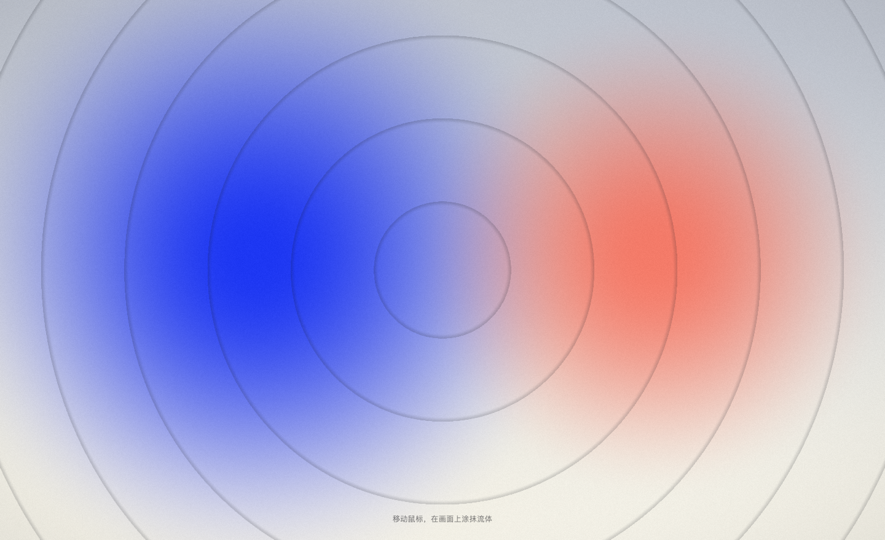
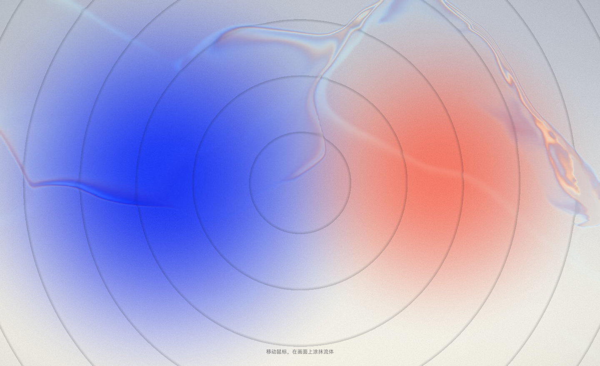
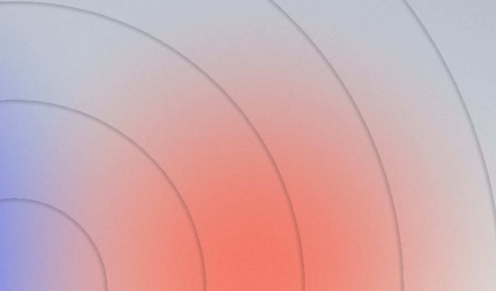
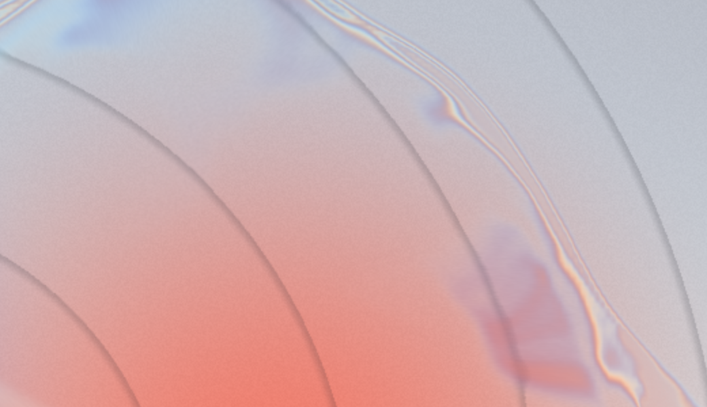
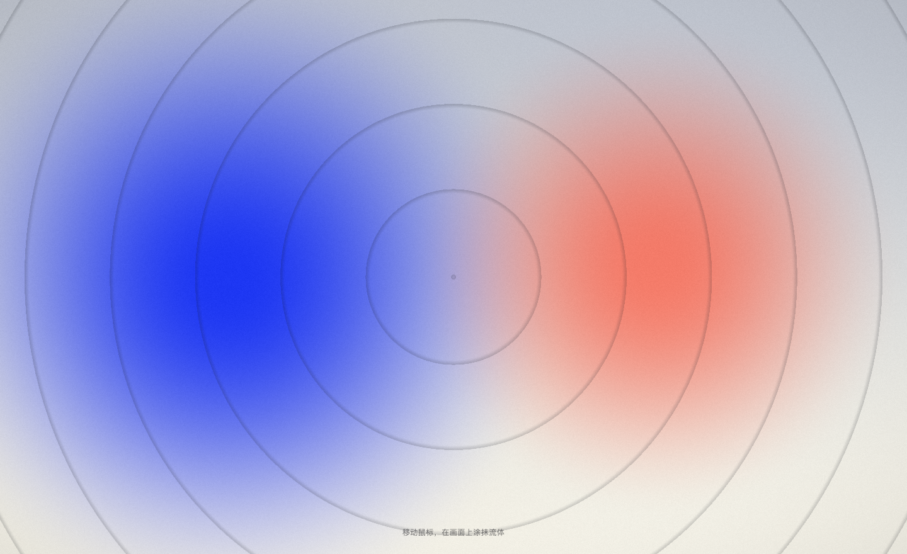

# 我以为是流体解算，结果只是一张贴图：复刻 Lusion 的屏幕流体特效


> 本文配套源码就是这个仓库，`npm install && npm run dev` 即可运行。

## 前言

这里是西伯利亚小火龙。

最近一直在复刻 Lusion 的网站，翻到他们一个鼠标特效页的时候停住了：鼠标划过去，整个画面像被手指搅了一下，跟着走、被拽变形，边缘还带点彩虹色的散光。松手之后，画面不会立刻弹回去，而是像水面一样慢慢晃平。

先上两张截图：





说实话，我第一反应是这玩意儿肯定上了 Navier-Stokes，不然怎么会有这么自然的流动感。结果 F12 一看，好家伙，人家连速度场都是自己拿一张 8bit 贴图画的，从头到尾没解什么方程。

那就有意思了。这篇文章就把这套“障眼法”拆开，用 Three.js 从头写一遍。

## 先看看它到底长什么样

静止的时候，画面就是一张很素的底图：米白到冷灰的渐变，一蓝一红两团软斑，外加几圈细同心圆。



看着平平无奇对吧？但细圆环是故意的。等会儿你就知道，这种细线在折射的时候最容易“露馅”，位移、色散都会被放大，看着就很有水感。

鼠标快速划一下，圆环会被掰弯，颜色也会跟着被拉开。松手之后墨迹不会马上消失，而是向四周摊开，再慢慢淡掉。

## 拆一下原理

整个效果其实就三层，我画个图：

```
鼠标轨迹
   │
   ▼
① ScreenPaint：1/4 分辨率的速度/墨量纹理
   │  （降采样 + 模糊成 1/8 速度场）
   ▼
② 底图渲染到 baseRT
   │  （底图 + 速度场）
   ▼
③ ScreenPaintDistortion：9 次偏移采样 + 色散
   │
   ▼
屏幕
```

抓住两个点就行。

速度场不是用来“算”的，是用来“推”的。它本身就是一张纹理，每帧被鼠标画一笔、被自己推一下、再衰减一点，仅此而已。

折射也不是改几何，是拿已经渲染好的画面当贴图，沿着速度方向多采几次样。你看到的“形变”，其实是采样位置错了。

想明白这两点，剩下的都是体力活。

## 用到的库

说出来你可能不信，这个效果正经用到的库就一个：

- Three.js

对，没有流体库，没有 GSAP，后处理也是自己接的（后面会提一嘴）。工程外壳是 Vite + 原生 JS，没上框架，代码拷到哪儿都能跑。

好，工具就这些，开始动手。

## 把数据结构定下来

一张 RGBA 纹理，四个通道塞了两类东西：

| 通道 | 存什么 | 备注 |
| --- | --- | --- |
| R | 速度 x + 0.5 | 8bit 存不了负数，整体偏 0.5 |
| G | 速度 y + 0.5 | 同上 |
| B | weight1 | 笔刷“墨量”，决定可见强度 |
| A | weight2 | 边缘附加量，掉得更快 |

为什么用 8bit？穷。1/4 分辨率下一张 4K 屏的模拟纹理才 960×540，显存和带宽基本可以忽略。代价就是速度得做偏移编码，还要额外处理量化死区——这个坑后面单独说。

建 RT 的时候准备四张，模拟两张做 ping-pong，模糊两张：

```js
const config = {
  minFilter: THREE.LinearFilter,
  magFilter: THREE.LinearFilter,
  format: THREE.RGBAFormat,
  type: THREE.UnsignedByteType, // 8bit，便宜
  depthBuffer: false,
  stencilBuffer: false,
};

// 模拟：当前帧 / 上一帧
this._currPaintRT = new THREE.WebGLRenderTarget(1, 1, config);
this._prevPaintRT = new THREE.WebGLRenderTarget(1, 1, config);

// 低分辨率速度场：原始 / 模糊中转
this._lowRT = new THREE.WebGLRenderTarget(1, 1, config);
this._lowBlurRT = new THREE.WebGLRenderTarget(1, 1, config);
```

尺寸是原站写死的比例：模拟 1/4，速度场 1/8。

```js
const paintW = Math.max(1, width >> 2);
const paintH = Math.max(1, height >> 2);
const lowW = Math.max(1, width >> 3);
const lowH = Math.max(1, height >> 3);
```

还有个细节，清屏不能清成黑色。速度 0 编码之后是 0.5，权重 0 就是 0，所以清屏色得是 `(0.5, 0.5, 0, 0)`：

```js
renderer.setClearColor(new THREE.Color(0.5, 0.5, 0), 0);
renderer.clear();
```

这里我直接传线性 RGB，不走 hex。写成 `new THREE.Color('#808080')` 的话，Three 会把它当成 sRGB 再转一次，速度就偏了。

## 开始画

每帧的模拟 pass，说穿了就三件事：把上一帧推一下、扣一点、再把本帧的鼠标线段画进去。

### 推：半拉格朗日平流

对每个像素，沿着速度反方向回溯到上一帧的位置去采样：

```glsl
vec4 lowData = texture2D(u_lowPaintTexture, v_uv);
// 0.5 - 编码值 = -速度，再乘一个强度
vec2 velInv = (0.5 - lowData.xy) * u_pushStrength;

vec4 data = texture2D(
  u_prevPaintTexture,
  v_uv + velInv * u_paintTexelSize
);
data.xy -= 0.5; // 解码
```

`u_pushStrength` 给 25。这个值越大，墨迹被带得越远，拖尾越长，手感上有点像在糖浆里搅。

### 扣：三个衰减系数

```glsl
// 速度 0.975 / weight1 0.95 / weight2 0.8
vec4 delta = (u_dissipations.xxyz - 1.0) * data;

// 本帧鼠标速度 × 覆盖率 = 新注入的速度
vec2 newVel = u_vel * d;
delta += vec4(newVel, radiusWeight.yy * d);

data += delta;
data.xy += 0.5;
gl_FragColor = clamp(data, vec4(0.0), vec4(1.0));
```

注意这里是 `(dissipation - 1.0) * data`，不是直接乘。因为衰减系数是乘在旧值上的，写成增量形式才能和注入量加在一起。

### 画：笔刷是一条有半径的线段

鼠标一帧只有一个点，直接按点画会断成一节一节。所以得把上一帧的终点当成本帧起点，连成线段，再算点到线段的距离：

```glsl
vec2 sdSegment(vec2 p, vec2 a, vec2 b) {
  vec2 pa = p - a;
  vec2 ba = b - a;
  float h = clamp(dot(pa, ba) / dot(ba, ba), 0.0, 1.0);
  return vec2(length(pa - ba * h), h);
}
```

返回的第二个值是投影位置，拿它插值起点和终点的半径：

```glsl
vec2 radiusWeight = mix(u_drawFrom.zw, u_drawTo.zw, res.y);
float d = 1.0 - smoothstep(-0.01, radiusWeight.x, res.x);
```

半径不是固定的，跟鼠标速度走：

```js
let radius = fit(speed, 0, 100, this.minRadius, this.maxRadius);
if (!hadMoved) radius = 0;
```

`maxRadius` 取 `max(40, 视口宽 / 20)`。所以快速甩一下，会拖出一条又粗又长的水袖；慢慢挪，就是一根细线。这个映射是整套效果“手感”的来源，调它比调 shader 管用。

## 为什么速度场要降采样再模糊

一开始我没加这步，直接用 1/4 的原始速度场回溯，结果画面全是网格状的锯齿，笔刷边缘也硬得像一个个圆盘子。

原因不复杂：8bit 本身精度就低，再叠上低分辨率，平流的时候误差会被放大。所以在模拟结束之后，把结果拷到 1/8，横向纵向各来一次 9-tap 模糊：

```glsl
vec4 color = texture2D(u_texture, v_uv) * 0.1633;
vec2 delta = u_delta;

color += texture2D(u_texture, v_uv - delta) * 0.1531;
color += texture2D(u_texture, v_uv + delta) * 0.1531;

delta += u_delta;
color += texture2D(u_texture, v_uv - delta) * 0.12245;
color += texture2D(u_texture, v_uv + delta) * 0.12245;

delta += u_delta;
color += texture2D(u_texture, v_uv - delta) * 0.0918;
color += texture2D(u_texture, v_uv + delta) * 0.0918;

delta += u_delta;
color += texture2D(u_texture, v_uv - delta) * 0.0510;
color += texture2D(u_texture, v_uv + delta) * 0.0510;
```

权重和刚好是 1，不用再除。半径写的是 8 个 texel，实际乘了 0.25，等效大概 2 个 texel。

这套组合下来，速度场又平滑又便宜，是整个效果能跑满帧的关键。

## 让画面“荡”起来

速度场准备好了，接下来才是你眼睛看到的部分。

折射 pass 不碰任何几何体，它只做一件事：拿已经画好的画面当贴图，沿着速度方向连续采 9 次，再取平均。

```glsl
vec4 data = texture2D(u_screenPaintTexture, v_uv);
float weight = (data.z + data.w) * 0.5;
vec2 vel = (0.5 - data.xy - 0.001) * 2.0 * weight;

vec2 velocity = vel * u_amount / 4.0 * u_screenPaintTexelSize * u_multiplier;

// 起点加一点噪声抖动，打散 9 个采样点的条带感
vec2 uv = v_uv + bnoise * velocity;
vec4 color = vec4(0.0);
for (int i = 0; i < 9; i++) {
  color += texture2D(u_texture, uv);
  uv += velocity;
}
color /= 9.0;
```

几个参数：

| 参数 | 默认值 | 干什么的 |
| --- | --- | --- |
| amount | 3 | 单步位移倍率，越大拖影越长 |
| multiplier | 5 | 整体折射幅度 |
| rgbShift | 0.5 | 色散强度 |
| colorMultiplier | 10 | 彩色条纹强度 |
| shade | 1.25 | 彩色条纹亮度 |

然后是最出效果的一步，按通道错相的 sin 条纹：

```glsl
vec3 rainbow =
  sin(vec3(vel.x + vel.y) * 40.0 + vec3(0.0, 2.0, 4.0) * u_rgbShift)
  * smoothstep(0.4, -0.9, weight)
  * u_shade
  * max(abs(vel.x), abs(vel.y))
  * u_colorMultiplier;

color.rgb += rainbow;
```

RGB 三个通道的相位分别错开 0、2、4，红绿蓝的条纹就不重合了，看起来就是色散。`smoothstep(0.4, -0.9, weight)` 是个反向区间，让条纹集中在墨量从 0 到 1 的过渡区，也就是笔刷边缘，而不是正中间。



## 松手之后

这里有个很容易被忽略的问题。

只做平流的话，鼠标停下之后残留速度还在，整团墨迹会顺着最后的方向继续平移，看着就像受重力往下滑，特别假。

原站本身有速度衰减，我在这个基础上又补了一段收力逻辑：停手 60ms 后开始收，140ms 内把“推动墨迹”的外部速度关掉。

```js
this._idleTime = hadMoved ? 0 : this._idleTime + dt;
const idle = fit(this._idleTime, 0.06, 0.2, 0, 1);
u.u_active.value = 1 - idle;
u.u_idleDamping.value = 1 - this.idleDampingStrength * idle;
```

对应到 shader：

```glsl
// 关掉整体推进
velInv *= u_active;

// 按墨量梯度向外扩散：墨从浓的地方流向稀的地方
vec2 weightGrad = vec2(
  (lowR.z + lowR.w) - (lowL.z + lowL.w),
  (lowU.z + lowU.w) - (lowD.z + lowD.w)
);
vec2 spread = weightGrad * (u_idleSpread * (1.0 - u_active));

// CFL 限制：单帧回溯不超过 0.75 个 texel，不然会数值发散
float spreadLen = length(spread);
if (spreadLen > 0.75) spread *= 0.75 / spreadLen;
velInv += spread;
```

改完之后的观感差别挺大：墨迹不再整体滑走，而是像滴在纸上的墨水一样向四周摊开，再淡掉。



## 被扭曲的底图也有讲究

折射需要一张“有参照物”的底图。纯色看不出形变，纯噪声又看不出方向。

所以我这张底图是程序化生成的，四样东西：

- 米白到冷灰的竖向渐变；
- 一团电光蓝、一团珊瑚红，用低频正余弦慢慢漂；
- 一圈圈细同心圆；
- 一层很轻的颗粒噪点，专门盖 8bit 色带。

圆环那段代码就三行：

```glsl
float f = fract(length(p) * 6.5 - u_time * 0.10);
float ring = smoothstep(0.94, 1.0, f);
color = mix(color, vec3(0.06, 0.07, 0.10), ring * 0.16);
```

为什么非得是细线？因为细线对位移和色散最敏感。同样的速度，放在大色块上你什么都看不出来，放在圆环上立刻就能看到“被掰弯”。很多流体 Demo 喜欢用网格、棋盘格，也是这个道理。

## 顺手接进后处理

这套东西本质上是两段式后处理，如果想让画面再电影一点，可以继续往后接 pass。我把折射包成了一个 `Pass`：

```js
class DistortionPass extends Pass {
  constructor(distortion, sourceRT) {
    super();
    this.distortion = distortion;
    this.sourceRT = sourceRT;
  }

  render(renderer, writeBuffer) {
    this.distortion.render(
      this.sourceRT.texture,
      this.renderToScreen ? null : writeBuffer
    );
  }
}
```

接完的链路是：

```
DistortionPass → Final（暗角/颗粒）→ Smaa → Fsr
```

每个都能单独开关，调参的时候方便对比。

## 几个我踩过的坑

都是实打实卡了我半天的那种。

**1. 8bit 有量化死区。**
按浮点思维写 `data *= 0.95`，存回 8bit 的时候小于 1/255 的值会被四舍五入回 1，尾巴永远散不掉，最后整屏发灰。必须给一个明确的最小衰减量，我这边是每帧 0.004。

```glsl
delta.zw = sign(delta.zw) * max(vec2(0.004), abs(delta.zw));
```

**2. ping-pong 一定要交换。**
同一张纹理又读又写在 WebGL 里是未定义行为。每帧先把 `prev` 和 `curr` 换一下，再往新的 `curr` 里写。

**3. 两套坐标别混。**
绘制用的是 NDC（左下原点，y 向上），算速度用的是 CSS 像素（左上原点，y 向下）。混着用的话，笔刷会出现在奇怪的位置，或者速度方向整个反过来。

**4. dt 要限幅。**
切后台再回来，`dt` 可能是几秒。一帧就能把速度场推到发散。我这边是 `Math.min(dt, 0.05)`。

**5. resize 之后重置鼠标基准。**
窗口大小一变，上一帧的鼠标坐标就失效了，第一帧会算出一个巨大的“跳变速度”，整屏直接被甩飞。

**6. 颜色空间。**
清 RT 的时候用线性值 `(0.5, 0.5, 0)`，别用 hex，避免被 sRGB 转换。

## 怎么跑起来

代码就在这个仓库里，一个最小可跑工程，依赖只有 Three.js：

```bash
npm install
npm run dev
# 打开终端里提示的地址
```

入口是 `index.html` + `main.js`，核心文件四个：

- `src/ScreenPaint.js`：速度场模拟
- `src/ScreenPaintDistortion.js`：折射、拖影、色散
- `src/fluidBase.js`：被扭曲的底图
- `src/FluidExperience.js`：渲染循环和 pass 编排

另外还有 `Input.js`（鼠标输入）、`FluidGUI.js`（右上角参数面板）、`math.js`（几个小工具），后处理那三个 pass（Final / Smaa / Fsr）也一起放进去了，不需要的话把 `src/FluidExperience.js` 里对应的 `addPass` 删掉就行。

原效果来自 Lusion，这里只是学习复刻，模型、贴图和视觉设计的版权都归他们。

## 最后说两句

这个效果最有意思的地方在于，它压根没解流体方程，但通过“速度编码 + 半拉格朗日平流 + 方向性模糊采样”这三板斧，把流体的视觉特征拆开又拼了回去。


如果这篇文章对你有帮助，点个赞再走。后面有空的话，我再写写同一套思路怎么接到文字、图片甚至 DOM 纹理上。

