# 手把手教你从空工程手搓一条月面长镜头：Lusion「月面叙事」复刻

> 这里是西伯利亚小火龙。之前发过一条沸点，说是预告，鸽了这么久，终于是完成了。

> [源代码](https://github.com/Embrace-oyo/lusion/tree/main/lunar-narrative)

这篇不是拆解。原理不先讲，先开工。

从空文件夹开始，一行行加到能滚出一条完整的月面长镜头：镜头从星空俯冲、掠过月面、穿过光柱和星尘，最后停在陨坑边。

丑话说在前头：three 走 npm（锁定 0.187，第 1 步装），模型和贴图是原站烘焙出来的二进制资产（`.buf` / `.webp`），第 2 步从仓库拷一次。除此之外，能贴的代码我全贴了，没有省略号。

---

## 0. 效果展示

四张图，都是本地 `npm run dev` 起来直接截的，没调色没合成。你做完了看到的应该是同一个东西。

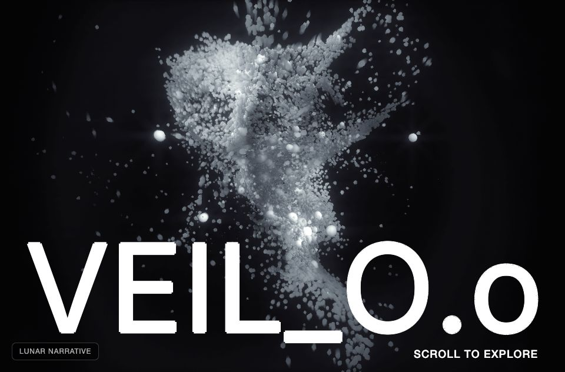

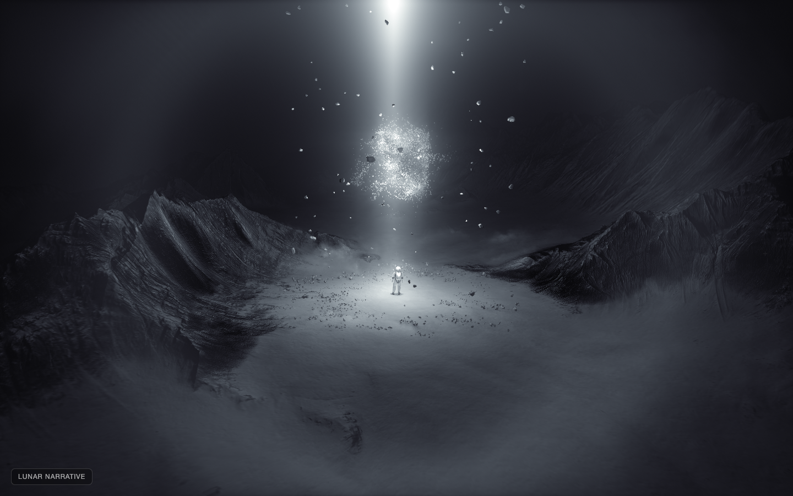

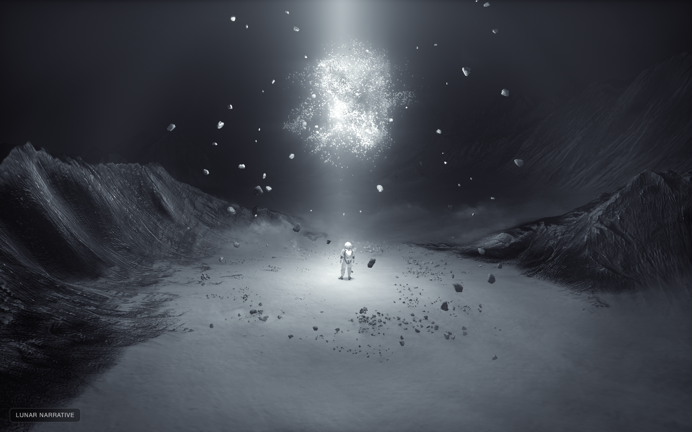

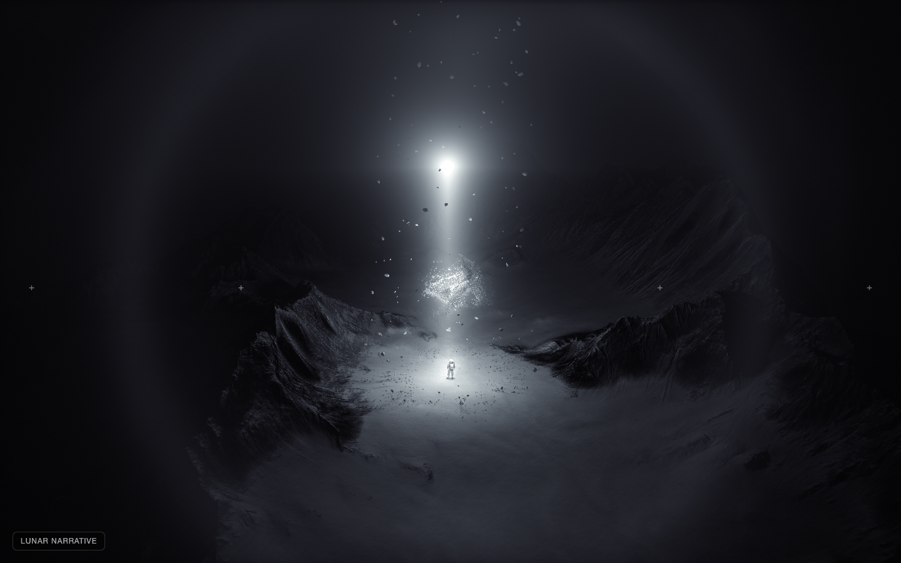

整片画面没有视频、没有序列帧、没有时间轴动画库。所有东西被一个数字驱动：

```js
const u = scrollY / window.innerWidth
```

滚动条就是时间轴，`u` 是播放头。相机、光柱粗细、雾的浓度、岩石什么时候升空、泛光多亮，全是 `u` 的函数。

路线图在下面。每一步都配一张验收画面：

| 步骤 | 做完你会看到 |
| --- | --- |
| 1 起工程 | 黑底上一个缓慢自转的线框球 |
| 2 搬资产 | 还是那个球，但控制台能取到地形文件 |
| 3 写 BufLoader | 控制台打印 `13872 顶点 / 80238 索引` |
| 4 相机上轨道 | 滚轮一滚，网格从脚下掠过 |
| 5 铺地形 | 一片诡异的青绿色（故意的，不是 bug） |
| 6 接后期 | 月面第一次正常，地平线开始发光 |
| 7 光柱 | 光从月面升起来，随滚动变粗 |
| 8 岩石 | 碎石从地面长出来、翻滚上升、投下软影 |
| 9 宇航员 | 陨坑边站着一个会呼吸的人 |
| 10 粒子 | 星尘铺开，被一张看不见的"光照场"照亮 |
| 11 标题 | VEIL 0.0 弹入，最后缩到左下角 |
| 12 总装 | 一镜到底，默认停在陨坑和宇航员 |
| 13 验收 | 稳帧，并且知道每个旋钮在哪 |
| 14 收尾 | 你可以开始改它了 |

前置知识不多：会 `npm run dev`，知道 Vue 单文件组件长什么样。剩下的每段 shader 都有中文注释，你负责粘贴、跑起来、调参。

---

## 1. 先把四条命跑通

第一版不画月面。黑底，一个自转的线框球，先证明四件事是通的：WebGL 能画、RAF 在跑、resize 不炸、卸载能清干净。

```bash
npm create vite@latest lunar-narrative -- --template vue
cd lunar-narrative
npm install

# three 锁定 0.187（与原站行为对齐，理由第 2 步细说）
npm install three@^0.187.0
```

装完就能 `import * as THREE from 'three'` 了。锁定 0.187 是为了和原站的着色器 / 混合行为对齐，别装最新版——理由第 2 步说。

`package.json` 里的版本号可能和你装到的对不上，以实际安装为准。下面这份是工程在用的：

```json
{
  "name": "lunar-narrative",
  "private": true,
  "version": "1.0.0",
  "description": "lusion.co/about 月面叙事长镜头的独立复刻版（Vue 3 + Vite）",
  "type": "module",
  "scripts": {
    "dev": "vite",
    "build": "vite build",
    "preview": "vite preview"
  },
  "dependencies": {
    "three": "^0.187.0",
    "vue": "^3.5.13"
  },
  "devDependencies": {
    "@vitejs/plugin-vue": "^5.2.1",
    "vite": "^6.0.7"
  }
}
```

`vite.config.js`：只挂 Vue 插件，不用给 three 配 alias——npm 装的 three 自带 `examples/jsm`，`import 'three/addons/...'` 直接可用。

```js
import { defineConfig } from 'vite'
import vue from '@vitejs/plugin-vue'

export default defineConfig({
  plugins: [vue()],
  server: {
    port: 5173,
    strictPort: false
  }
})
```

`index.html` 只有一个 `#app`，DOM 骨架交给 Vue：

```html
<!DOCTYPE html>
<html lang="zh-CN">
  <head>
    <meta charset="UTF-8" />
    <meta name="viewport" content="width=device-width, initial-scale=1.0" />
    <title>月面叙事 · Lunar Narrative</title>
  </head>
  <body>
    <div id="app"></div>
    <script type="module" src="/src/main.js"></script>
  </body>
</html>
```

`src/main.js`：入口顺手关掉 three 的颜色管理——原站 bundle 里就是关的，不关的话 hex 颜色会被转到线性空间，整场月面会偏暗。

```js
import * as THREE from 'three'
import { createApp } from 'vue'
import App from './App.vue'
import './styles.css'

// 与原站保持一致：关闭颜色管理，hex 颜色按显示空间原值进着色器
THREE.ColorManagement.enabled = false

createApp(App).mount('#app')
```

页面分两层：`App.vue` 只做外壳——渲染页面组件，再加一个首帧黑场遮罩；真正的页面骨架（滚动行程、标题锚点、WebGL 生命周期）在 `src/views/AboutView.vue`。这和源站 `/about` 的组织一致，两份都是最终形态，后面不用再改。

首帧遮罩靠一个就绪信号收尾：`AboutView` 加载完调 `markPageReady()`，`App.vue` 等它再淡出遮罩；带超时兜底，资源异常也不会一直黑屏。

`src/core/pageReady.js`：（单页项目只用到 `markPageReady` / `waitPageReady`，`resetPageReady` 保留以与源站组织一致）

```js
/**
 * pageReady.js — 页面就绪信号
 *
 * AboutView 在首帧 / 资源加载完成后调用 markPageReady()；
 * App.vue 用 waitPageReady(timeout) 等它，超时兜底避免卡死。
 *
 * 这里的 ready / waiters 是模块级单例状态，整个应用共享同一份。
 */

// ready：当前页面是否已就绪；waiters：就绪前注册的等待回调队列
let ready = false;
let waiters = [];

/**
 * 标记当前页面已就绪
 * 幂等：重复调用直接返回。首次调用时把队列里的等待者全部唤醒并清空。
 */
export function markPageReady() {
  if (ready) return;
  ready = true;
  // 先把队列换出再遍历：回调内部若再次注册等待者，不会影响本次的列表
  const list = waiters;
  waiters = [];
  for (const fn of list) fn();
}

/**
 * 重置就绪状态 — 每次进入新页面前调用，让 waitPageReady 重新开始等待
 * 单页项目用不到，保留以与源站组织一致
 */
export function resetPageReady() {
  ready = false;
  waiters = [];
}

/**
 * 等待当前页面就绪
 * @param {number} [timeout=4000] — 超时毫秒数，超时后 resolve(false) 而不是 reject
 * @returns {Promise<boolean>} — true=页面确实就绪；false=超时兜底
 *
 * 超时存在的原因：资源 404 / shader 编译失败可能永远不会调用 markPageReady，
 * 没有兜底的话 loading 遮罩会一直盖住页面。
 */
export function waitPageReady(timeout = 4000) {
  // 已经就绪 → 直接同步返回一个已 resolve 的 Promise，避免多一次事件循环
  if (ready) return Promise.resolve(true);
  return new Promise((resolve) => {
    // 超时兜底：到点后返回 false，调用方仍会继续揭幕
    const timer = setTimeout(() => resolve(false), timeout);
    // 正常路径：就绪时清掉定时器并返回 true
    waiters.push(() => {
      clearTimeout(timer);
      resolve(true);
    });
  });
}
```

`src/App.vue`：

```vue
<template>
  <AboutView />
  <div v-if="bootVisible" class="boot" :class="{ hidden: bootHidden }">LOADING</div>
</template>

<script setup>
import { onMounted, ref } from 'vue';
import AboutView from './views/AboutView.vue';
import { waitPageReady } from './core/pageReady.js';

const bootVisible = ref(true);
const bootHidden = ref(false);

onMounted(async () => {
  await waitPageReady(15000);
  bootHidden.value = true;
  setTimeout(() => {
    bootVisible.value = false;
  }, 900);
});
</script>

<style scoped>
.boot {
  position: fixed;
  inset: 0;
  z-index: 100;
  display: grid;
  place-items: center;
  background: #000;
  font-size: 12px;
  letter-spacing: 0.3em;
  color: rgba(255, 255, 255, 0.55);
  transition: opacity 0.8s ease;
}

.boot.hidden {
  opacity: 0;
  pointer-events: none;
}
</style>
```

`src/views/AboutView.vue`：页面骨架和 WebGL 生命周期都在这。`.track` 的长度就是"电影"的长度——`u = scrollY / innerWidth`，`400vw` 意味着 `u` 最大到 4（陨坑全景）。`hostEl` / `introEl` / `logoEl` 三个 ref 传给 `mount`：`hostEl` 挂 canvas，`introEl` 查 `.intro-scroll` 做淡出，`logoEl` 是标题的 DOM 锚点。

```vue
<template>
  <div class="page">
    <!-- 滚动行程：u = scrollY / innerWidth，限制到 u = 4（陨坑全景） -->
    <div class="track"></div>

    <div class="stage">
      <div ref="hostEl" class="host"></div>

      <div ref="introEl" class="intro">
        <div ref="logoEl" class="intro-logo"></div>
        <div class="intro-scroll">SCROLL TO EXPLORE</div>
      </div>

      <div class="crosses">
        <span>+</span><span>+</span><span>+</span><span>+</span><span>+</span>
      </div>
    </div>
  </div>
</template>

<script setup>
import { onBeforeUnmount, onMounted, ref } from 'vue';
import { AboutExperience } from '../effects/AboutExperience.js';
import { markPageReady } from '../core/pageReady.js';

const hostEl = ref(null);
const introEl = ref(null);
const logoEl = ref(null);

let experience = null;

onMounted(() => {
  experience = new AboutExperience();
  experience
    .mount(hostEl.value, { introEl: introEl.value, logoEl: logoEl.value })
    .then(markPageReady)
    .catch(() => markPageReady());
});

onBeforeUnmount(() => {
  experience?.dispose();
  experience = null;
});
</script>

<style scoped>
.page {
  position: relative;
  background: #000;
}

/* 最大滚动 = 4 × 视口宽（再减掉一屏视口高，得到 u 上限 = 4） */
.track {
  height: calc(400vw + 100vh);
  pointer-events: none;
}

.stage {
  position: fixed;
  inset: 0;
  overflow: hidden;
  font-family: 'Helvetica Neue', Helvetica, Arial, sans-serif;
  color: #fff;
}

.host {
  position: absolute;
  inset: 0;
}

.host :deep(canvas) {
  display: block;
  width: 100%;
  height: 100%;
}

.intro {
  position: fixed;
  inset: 0;
  z-index: 6;
  pointer-events: none;
}

.intro-logo {
  position: absolute;
  left: 5vw;
  top: 64.4vh;
  width: 90vw;
  height: 18.1vw;
}

.intro-scroll {
  position: absolute;
  right: 4.8vw;
  top: 93.7vh;
  font-size: clamp(13px, 1.91vw, 26px);
  line-height: 1;
  letter-spacing: 0.06em;
  font-weight: 500;
  will-change: transform, opacity;
}

.crosses {
  position: fixed;
  left: 0;
  right: 0;
  top: 50%;
  z-index: 5;
  display: flex;
  justify-content: space-between;
  padding: 0 46px;
  color: rgba(255, 255, 255, 0.45);
  font-size: 15px;
  pointer-events: none;
  opacity: 0;
}
</style>
```

`src/styles.css`：只剩全局 reset。`.page` / `.track` / `.stage` / `.host` / `.intro` / `.crosses` 这些页面样式都在上面 `AboutView.vue` 的 scoped 样式里。

```css
* {
  margin: 0;
  padding: 0;
  box-sizing: border-box;
}

html,
body,
#app {
  width: 100%;
  height: 100%;
  background: #000;
  color: #fff;
}

body {
  overflow-x: hidden;
  font-family: -apple-system, BlinkMacSystemFont, 'Segoe UI', 'PingFang SC', Roboto, sans-serif;
}
```

`src/effects/AboutExperience.js`：这一版只有骨架和一个占位球。后面每一步都长在这个文件上，最终三千多行。我只贴"这一步要改的地方"；标了"整段替换"的，就把同名方法整段换掉。

```js
import * as THREE from 'three'

export class AboutExperience {
  constructor() {
    this._disposed = false
    this._time = 0
    this._scrollY = 0
    this._pointerDown = false
    this._mouse = { x: 0, y: 0 }
    this.freezeRatio = 0
    this._raf = 0
  }

  mount(host, els = {}) {
    this.host = host
    this.els = els

    const renderer = new THREE.WebGLRenderer({
      antialias: true,
      alpha: false,
      powerPreference: 'high-performance'
    })
    renderer.setPixelRatio(Math.min(window.devicePixelRatio || 1, 2))
    renderer.setSize(host.clientWidth || window.innerWidth, host.clientHeight || window.innerHeight)
    renderer.outputColorSpace = THREE.SRGBColorSpace
    // 关掉自动清屏：后面阴影 / 雾 / 后期都要手动控制
    renderer.autoClear = false
    host.appendChild(renderer.domElement)
    this.renderer = renderer

    this.scene = new THREE.Scene()
    this.camera = new THREE.PerspectiveCamera(60, 1, 1, 200)
    this.camera.position.set(0, 6, 18)

    // 占位球：第 4 步会删掉
    this.placeholder = new THREE.Mesh(
      new THREE.IcosahedronGeometry(4, 1),
      new THREE.MeshBasicMaterial({ wireframe: true, color: 0x77ccff })
    )
    this.scene.add(this.placeholder)

    this._onScroll = () => { this._scrollY = window.scrollY || 0 }
    this._onResize = () => this.resize()
    this._onPointerMove = (e) => {
      this._mouse.x = (e.clientX / window.innerWidth) * 2 - 1
      this._mouse.y = -(e.clientY / window.innerHeight) * 2 + 1
    }
    this._onPointerDown = () => { this._pointerDown = true }
    this._onPointerUp = () => { this._pointerDown = false }

    window.addEventListener('scroll', this._onScroll, { passive: true })
    window.addEventListener('resize', this._onResize)
    window.addEventListener('pointermove', this._onPointerMove)
    window.addEventListener('pointerdown', this._onPointerDown)
    window.addEventListener('pointerup', this._onPointerUp)
    window.addEventListener('pointercancel', this._onPointerUp)

    this.resize()
    this._lastT = performance.now()
    this._tick = () => {
      if (this._disposed) return
      this._raf = requestAnimationFrame(this._tick)
      this._renderFrame()
    }
    this._raf = requestAnimationFrame(this._tick)
  }

  resize() {
    if (!this.renderer) return
    const w = this.host.clientWidth || window.innerWidth
    const h = this.host.clientHeight || window.innerHeight
    this.renderer.setPixelRatio(Math.min(window.devicePixelRatio || 1, 2))
    this.renderer.setSize(w, h)
    this.camera.aspect = w / Math.max(1, h)
    this.camera.updateProjectionMatrix()
  }

  _renderFrame() {
    const now = performance.now()
    let dt = (now - this._lastT) / 1000
    this._lastT = now
    if (!Number.isFinite(dt)) dt = 0
    dt = Math.min(dt, 0.05)
    this._time += dt

    this.placeholder.rotation.y += dt * 0.3
    this.placeholder.rotation.x += dt * 0.12

    this.renderer.setRenderTarget(null)
    this.renderer.setClearColor(0x000000, 0)
    this.renderer.clear(true, true, true)
    this.renderer.render(this.scene, this.camera)
  }

  dispose() {
    this._disposed = true
    cancelAnimationFrame(this._raf)
    window.removeEventListener('scroll', this._onScroll)
    window.removeEventListener('resize', this._onResize)
    window.removeEventListener('pointermove', this._onPointerMove)
    window.removeEventListener('pointerdown', this._onPointerDown)
    window.removeEventListener('pointerup', this._onPointerUp)
    window.removeEventListener('pointercancel', this._onPointerUp)
    this.scene?.traverse((o) => {
      o.geometry?.dispose?.()
      if (o.material) {
        const mats = Array.isArray(o.material) ? o.material : [o.material]
        mats.forEach((m) => m.dispose?.())
      }
    })
    this.renderer?.dispose()
    this.renderer?.domElement?.remove()
  }
}
```

`npm run dev`，打开 `http://localhost:5173`。纯黑背景上一个蓝色线框球，转得很慢；滚动条很长，但画面不动——正常，滚动还没接上。

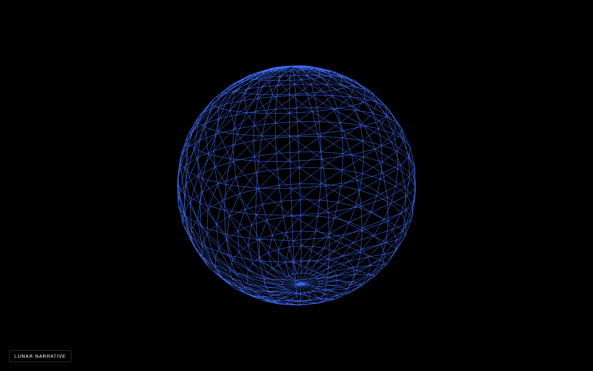

先做这个，是因为后面所有系统都建立在这四条命上：RAF 循环、resize、滚动监听、dispose。基础设施在这里搭歪了，后面每加一个东西都会多一个幽灵 bug。

`autoClear = false` 之后必须手动 `clear()`。后面要让多个 pass 往同一张图上叠，第一帧就得养成习惯。忘了清屏的现象是鬼影拖尾。

`host.clientWidth` 在布局完成前可能是 0，所以都要 `|| window.innerWidth` 兜底。

HMR 时如果不 `cancelAnimationFrame`，旧循环还在跑。这个现象特别好认：改一行代码，球突然转快一倍。

---

## 2. 搬家

页面还是那个球。但工程里已经有完整的运行时和资产，控制台能取到地形文件。

从复刻仓库拷资产目录到工程根目录，路径换成你自己的：

```bash
mkdir -p ./public
cp -R /path/to/lunar-narrative/public/assets ./public/assets
```

拷完目录长这样：

```
你的工程/
├── public/assets/
│   ├── models/about/*.buf        # 地形、相机样条、岩石、人物、粒子球、标题…
│   └── textures/                 # 地面三通道图、雾、蓝噪声、人物投影
├── src/
└── vite.config.js
```

资产先混个脸熟，后面每一步用到哪几个我再点：

| 文件 | 内容 | 谁用 |
| --- | --- | --- |
| `terrain.buf` | 13872 顶点 / 80238 索引的地形网格 | 第 5 步 |
| `camera_spline.buf` | 200 个采样点的位置 + 朝向四元数 | 第 4 步 |
| `bg_box.buf` | 远景散射盒 | 第 7 步 |
| `rock_0..3.buf` / `rock_*_low.buf` / `rock_animation_*.buf` | 4 种岩石高模 / 低模 / 16 片 × 120 帧烘焙动画 | 第 8 步 |
| `person_idle.buf` | 4590 顶点，54 骨骼 × 85 帧 idle | 第 9 步 |
| `sphere_l/m/s/xs.buf` | 粒子球体四档 LOD | 第 10 步 |
| `logo_text.buf` | 8 个字形的「VEIL 0.0」 | 第 11 步 |
| `textures/about/terrain_shadow_light_height.webp` | 一张图三通道：阴影 / 光照 / 高度 | 第 5 步 |
| `textures/LDR_RGB1_0.png` | 128×128 蓝噪声 | 第 5 步 |
| `textures/about/fog.png` / `textures/about/ground_person_shadow.webp` | 雾片 / 人物投影 | 第 7、9 步 |

控制台跑一下：

```js
fetch('/assets/models/about/terrain.buf')
  .then(r => console.log(r.status, r.headers.get('content-length')))
```

应该返回 `200` 和一个几百 KB 的数字。`404` 就是 `public/assets` 放错层了——Vite 的 `public` 目录直接映射到站点根路径，所以代码里写 `/assets/...`，不要写 `/public/assets/...`。

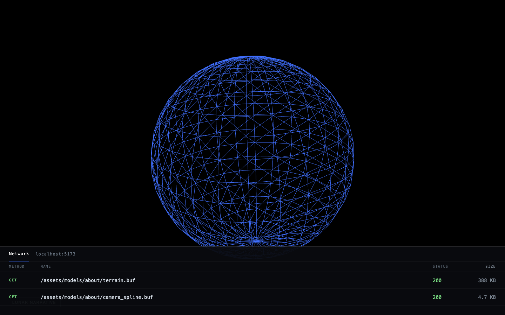

three 锁定 0.187，别 `npm i three` 装最新的：原站的泛光、SMAA、FSR 都是按这个版本的行为写的，升到新版后混合模式和色彩管理能给你整出一堆惊喜——最典型的是第 9 步人物影子会变成一块白斑（第 13 步坑 4 有解法，但锁定版本更省心）。`package.json` 里写 `"three": "^0.187.0"`，`^` 会锁在 0.187.x，不会跳到 0.188。

色彩管理在 `main.js` 里关掉（`THREE.ColorManagement.enabled = false`），和原站一致。

---

## 3. 先写一个 `.buf` 解析器

目标就一行输出：`13872 顶点 / 80238 索引`。画面不变。

`.buf` 是 Lusion 自己导出的格式，结构简单得有点浪费：

```
┌────────────────────┬───────────────────────┬──────────────────┐
│ uint32 小端: 头长度 │ 头长度字节的 JSON 头    │ 二进制 payload    │
└────────────────────┴───────────────────────┴──────────────────┘
```

JSON 头里写着顶点数、索引数，以及每个属性（position / normal / uv / char…）的类型、分量数、是否量化。payload 按属性声明顺序紧密排列，没有 padding。

新建 `src/core/BufLoader.js`，下面的代码可以直接整份粘：

```js
import * as THREE from 'three'

const TYPED = {
  Float32Array, Uint32Array, Int32Array,
  Uint16Array, Int16Array, Uint8Array, Int8Array
}

// 有符号类型的量化范围是 [MIN, MAX]，不是 [0, MAX]
const QUANT_RANGE = {
  Uint8Array: [0, 255],
  Int8Array: [-128, 127],
  Uint16Array: [0, 65535],
  Int16Array: [-32768, 32767],
  Uint32Array: [0, 4294967295],
  Int32Array: [-2147483648, 2147483647]
}

export function parseBuf(arrayBuffer) {
  const bytes = new Uint8Array(arrayBuffer)
  const view = new DataView(arrayBuffer)

  // 1. 头长度（小端）+ JSON 头
  const headerLen = view.getUint32(0, true)
  const header = JSON.parse(new TextDecoder('utf-8').decode(bytes.subarray(4, 4 + headerLen)))
  const { vertexCount, indexCount, attributes } = header

  // 2. 按声明顺序切 payload
  let offset = 4 + headerLen
  const buffers = {}

  for (const attr of attributes) {
    const Ctor = TYPED[attr.storageType]
    if (!Ctor) throw new Error(`BufLoader: 不支持的 storageType "${attr.storageType}"`)

    const count = attr.id === 'indices' ? indexCount : vertexCount
    const total = count * attr.componentSize

    // 必须 slice 拷贝：subarray 在 offset 非元素整数倍时会抛 RangeError
    const src = new Ctor(arrayBuffer.slice(offset, offset + total * Ctor.BYTES_PER_ELEMENT))
    offset += total * Ctor.BYTES_PER_ELEMENT

    // 3. 反量化
    if (attr.needsPack && attr.packedComponents) {
      const [min, max] = QUANT_RANGE[attr.storageType]
      const range = max - min
      const out = new Float32Array(total)
      for (let i = 0; i < count; i++) {
        for (let c = 0; c < attr.componentSize; c++) {
          const p = attr.packedComponents[c]
          const raw = src[i * attr.componentSize + c]
          out[i * attr.componentSize + c] = p.from + ((raw - min) / range) * p.delta
        }
      }
      buffers[attr.id] = out
    } else {
      buffers[attr.id] = src
    }
  }

  return { vertexCount, indexCount, meshType: header.meshType, attributes: buffers }
}

export function bufToGeometry(arrayBuffer) {
  const { vertexCount, attributes } = parseBuf(arrayBuffer)
  const geo = new THREE.BufferGeometry()

  if (attributes.position) geo.setAttribute('position', new THREE.BufferAttribute(attributes.position, 3))
  if (attributes.normal) geo.setAttribute('normal', new THREE.BufferAttribute(attributes.normal, 3))
  if (attributes.uv) geo.setAttribute('uv', new THREE.BufferAttribute(attributes.uv, 2))

  if (attributes.indices) {
    geo.setIndex(new THREE.BufferAttribute(attributes.indices, 1))
  } else {
    const idx = new Uint32Array(vertexCount)
    for (let i = 0; i < vertexCount; i++) idx[i] = i
    geo.setIndex(new THREE.BufferAttribute(idx, 1))
  }

  // 自定义属性（char / piece / instanceRands…）原样挂上
  for (const [id, data] of Object.entries(attributes)) {
    if (['position', 'normal', 'uv', 'indices'].includes(id)) continue
    const size = data.length / vertexCount
    if (Number.isInteger(size) && size > 0 && size <= 4) {
      geo.setAttribute(id, new THREE.BufferAttribute(data, size))
    }
  }

  if (!attributes.normal) geo.computeVertexNormals()
  geo.computeBoundingSphere()
  return geo
}

export async function loadBuf(url) {
  const res = await fetch(url)
  if (!res.ok) throw new Error(`BufLoader: 加载失败 ${url} (${res.status})`)
  return bufToGeometry(await res.arrayBuffer())
}
```

然后在 `AboutExperience.js` 里加 `_loadAssets()`。`mount` 改两处：签名前面加 `async`，在 `this.resize()` 之前加一行 `await this._loadAssets()`。方法本体：

```js
import { loadBuf } from '../core/BufLoader.js'

async _loadAssets() {
  const BASE = '/assets/'
  const terrain = await loadBuf(BASE + 'models/about/terrain.buf')
  this.terrainGeo = terrain
  console.log(
    '[lunar] terrain',
    terrain.getAttribute('position').count, '顶点 /',
    terrain.index.count, '索引'
  )
}
```

控制台多一行 `[lunar] terrain 13872 顶点 / 80238 索引`，画面还是线框球。

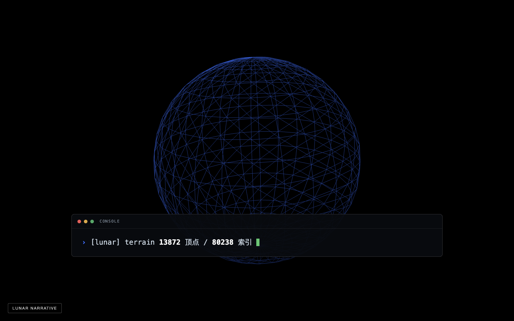

这把钥匙之后能打开所有 `.buf`。地形、样条、岩石、人物、标题，只是同一个解析器的不同输入。

两个坑，以后还会回来找你。

有符号整型反量化不能除以 MAX。导出器写 Int16 时用的是 `(v * 65535) - 32768`，所以解码必须是 `(raw - min) / (max - min)`。习惯性写 `raw / 32767`，法线的负半轴会整体错位，现象是模型一半亮一半黑、自阴影全乱。这东西看着特别像光照 bug，会把人往错的方向带。

`subarray` 的对齐陷阱。payload 没有 padding，`offset` 不一定是 4 的倍数；直接 `new Float32Array(buffer.subarray(...))` 会抛 `RangeError`。`slice()` 拷一份，让 TypedArray 从字节 0 开始对齐，问题消失。

---

## 4. 给相机铺一条 200 点的轨道

轨道是现成的，接到滚动条上就行。滚轮一滚，镜头沿着一条看不见的轨道飞；鼠标让画面轻微摆头；按住鼠标时间变慢。

先把 `_loadAssets` 换成这版，多读一条相机样条：

```js
async _loadAssets() {
  const BASE = '/assets/'
  const [spline, terrain] = await Promise.all([
    loadBuf(BASE + 'models/about/camera_spline.buf'),
    loadBuf(BASE + 'models/about/terrain.buf')
  ])
  this.spline = spline
  this.terrainGeo = terrain
  console.log('[lunar] terrain', terrain.getAttribute('position').count, '顶点 /', terrain.index.count, '索引')
  console.log('[lunar] spline', spline.getAttribute('position').count, '个采样点')
}
```

再在 `mount` 里、`await this._loadAssets()` 之前，建一张全局共享 uniform 表。后面所有材质都从这里拿参数，改一处全场景生效：

```js
this.lightPosition = new THREE.Vector3(0, 8, 0)
this.scatterPos0 = new THREE.Vector3(0, 18, 0)
this.scatterPos1 = new THREE.Vector3(0, 0, 0)

this.shared = {
  u_lightPosition: { value: this.lightPosition },
  u_lightColor: { value: new THREE.Color('#000') },
  u_lightScatterDivider: { value: new THREE.Vector2(1.1, 5.5) },
  u_lightScatterPowInv: { value: 1 },
  u_lightScatterRatio: { value: 1 },
  u_lightScatterPos0: { value: this.scatterPos0 },
  u_lightScatterPos1: { value: this.scatterPos1 },
  u_sceneRatio: { value: 0 },
  u_introTime: { value: 0 },
  u_introDeltaTime: { value: 0 },
  u_time: { value: 0 },
  u_bgColor: { value: new THREE.Color('#000') },
  u_sceneHideRatio: { value: 0 },
  u_noiseStableFactor: { value: 0 },
  u_blueNoiseTexture: { value: null },
  u_blueNoiseTexelSize: { value: new THREE.Vector2(1 / 128, 1 / 128) },
  u_blueNoiseCoordOffset: { value: new THREE.Vector2() },
  u_resolution: { value: new THREE.Vector2(1, 1) }
}
```

删掉占位球，换一个网格当参照物。你能看见镜头在动，靠的就是它：

```js
// 删掉 this.placeholder 那三行，换成：
const grid = new THREE.GridHelper(120, 120, 0x2a4a66, 0x152a3a)
grid.position.y = -1.02
this.scene.add(grid)
```

文件顶部、`export class` 之前，加三个工具函数：

```js
const saturate = (v) => Math.min(1, Math.max(0, v))
const mix = (a, b, t) => a + (b - a) * t
const fit = (x, a, b, c, d) => (a === b ? c : c + (d - c) * saturate((x - a) / (b - a)))
const ease = {
  cubicOut: (t) => 1 - Math.pow(1 - t, 3),
  cubicIn: (t) => t * t * t,
  sineInOut: (t) => -(Math.cos(Math.PI * t) - 1) / 2
}
```

相机本体。`camera_spline.buf` 存了 200 个点，每点一个位置加一个朝向四元数；实际只用前 149 段：

```js
_updateCamera(initialSplineRatio) {
  const P = this.spline.attributes.position.array
  const Q = this.spline.attributes.orient.array
  const count = P.length / 3

  const t = saturate(initialSplineRatio) * Math.min(149, count - 1)
  const i = Math.floor(t)
  const j = Math.min(count - 1, Math.ceil(t))
  const a = t - i

  const p = new THREE.Vector3().fromArray(P, i * 3).lerp(new THREE.Vector3().fromArray(P, j * 3), a)
  const q0 = new THREE.Quaternion().fromArray(Q, i * 4)
  const q1 = new THREE.Quaternion().fromArray(Q, j * 4)
  q0.slerp(q1, a)

  const look = new THREE.Vector3(0, 0, 1).applyQuaternion(q0).add(p)
  this.camera.position.copy(p)
  this.camera.lookAt(look)

  // 鼠标 look 偏移：乘在相机四元数后面，带阻尼
  const lookTX = Math.min(1, Math.max(-1, this._mouse.y)) * 0.1
  const lookTY = Math.min(1, Math.max(-1, -this._mouse.x)) * 0.1
  this._lookX = (this._lookX || 0) + (lookTX - (this._lookX || 0)) * 0.1
  this._lookY = (this._lookY || 0) + (lookTY - (this._lookY || 0)) * 0.1
  this._lookEuler = this._lookEuler || new THREE.Euler()
  this._lookQuat = this._lookQuat || new THREE.Quaternion()
  this._lookEuler.set(this._lookX, this._lookY, 0)
  this._lookQuat.setFromEuler(this._lookEuler)
  this.camera.quaternion.multiply(this._lookQuat)
}

_dolly(r) {
  const k = saturate((r - 0.4) / 0.4)
  return mix(0, -10, ease.sineInOut(k))
}
```

最后整段替换 `_renderFrame`。重点是中间那四行，整个工程的"播放头"：

```js
_renderFrame() {
  const now = performance.now()
  let dt = (now - this._lastT) / 1000
  this._lastT = now
  if (!Number.isFinite(dt)) dt = 0
  dt = Math.min(dt, 0.05)
  this._time += dt

  // 子弹时间：按住鼠标，时间缩到 10%，用阻尼过渡
  this.freezeRatio += ((this._pointerDown ? 1 : 0) - this.freezeRatio) * 0.1
  const frozenDt = dt * (1 + (0.1 - 1) * this.freezeRatio)
  this.introTime = (this.introTime || 0) + frozenDt

  const H = this.renderer.domElement.height / this.renderer.getPixelRatio()
  const vw = Math.max(1, window.innerWidth)

  // u 以视口宽为单位，换屏幕尺寸不改变叙事节奏
  const u = this._scrollY / vw
  const initialSplineRatio = fit(u, 0, 5.25, 0, 1)
  const introRatio = saturate(u / 5.25)
  const sceneRatio = fit(introRatio, 0.01, 0.1, 0, 1)

  this._updateCamera(initialSplineRatio)
  this.camera.fov = 60 + this._dolly(initialSplineRatio)
  this.camera.aspect = vw / Math.max(1, H)
  this.camera.updateProjectionMatrix()

  const s = this.shared
  s.u_sceneRatio.value = sceneRatio
  s.u_sceneHideRatio.value = fit(introRatio, 0.85, 1, 0, 1)
  s.u_introTime.value = this.introTime
  s.u_introDeltaTime.value = frozenDt
  s.u_time.value = this._time
  s.u_resolution.value.set(this.renderer.domElement.width, this.renderer.domElement.height)
  if (!this.particles) s.u_noiseStableFactor.value = 0.5 + 0.5 * Math.sin(this._time * 0.35)

  this.renderer.setRenderTarget(null)
  this.renderer.setClearColor(0x000000, 0)
  this.renderer.clear(true, true, true)
  this.renderer.render(this.scene, this.camera)
}
```

滚动时网格从脚下飞速掠过，镜头有俯冲、有翻滚；鼠标移动画面轻轻摆一下；按住鼠标，网格的移动没有变化——时间减速作用在场景动画上，相机是滚动驱动的。这正常，等第 8 步岩石进来，减速就明显了。

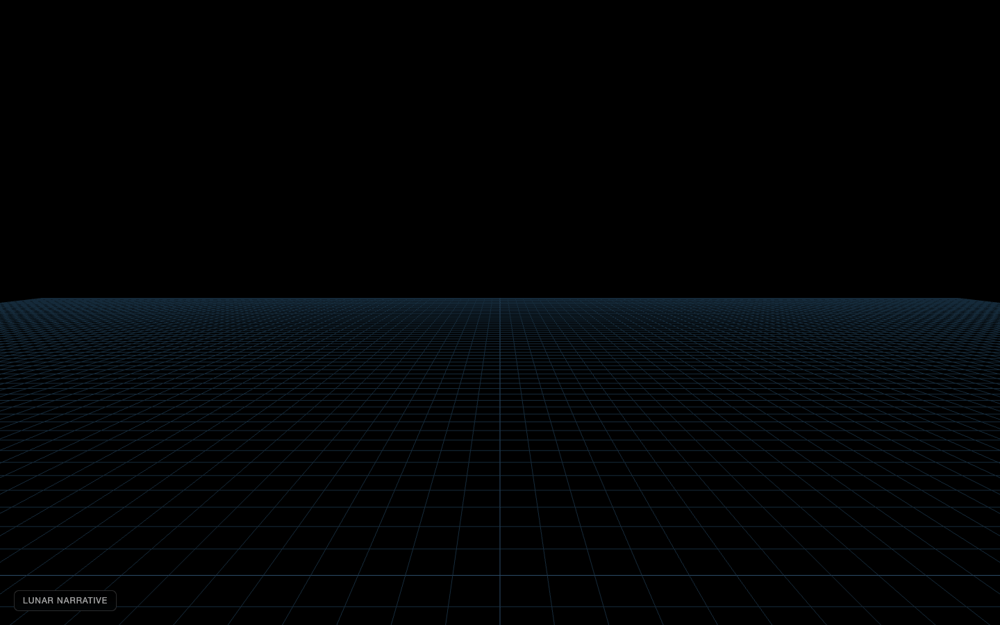

有几个地方当时想得比较久。

除以 `innerWidth` 而不是 `innerHeight`，是因为横向视野由宽度决定，纵向只是裁切。用宽度做单位，竖屏和带鱼屏看到的是同一段剧情，只是裁切不同。全站最便宜的一次响应式设计。

朝向必须用四元数 `slerp`。对欧拉角做线性插值，镜头翻滚的段落会出现万向节抖动，画面会抽一下。

注视点 = 位置 + 朝向向量。四元数描述的是"镜头往前看的方向"，不是目标点。把朝向作用到 `+Z` 上再加位置，等价于原站 CameraControls 的做法。

FOV 60 → 50 是假推轨。不是真的推镜头，是改 FOV：背景被压扁、前景不变，观众会产生"空间在拉伸"的错觉。电影里叫 dolly zoom，Web 里就是一个数字。

`sceneRatio` 这行我原本写的是 `fit(introRatio, 0.01, 0.1, 0, 1, ease.cubicOut)`，但 `fit` 只认五个参数，第六个会被 JS 默默丢掉，所以淡入其实是线性的。想让它更软，把 `fit` 改成接受缓动函数，别指望多传一个参数就生效。这个坑不致命，但"为什么我改了缓动没反应"能困住半小时。

---

## 5. 地形，和一张四通道图

地形出现。但画面是一片诡异的青绿色。故意的，不是 bug。

地形着色器太长，而且和四个工具函数互相依赖，我不在这里重打一遍，免得你抄错。从仓库的 `AboutExperience.js` 里整段拷下面这些常量到文件顶部，搜名字就能定位：

- `GROUND_VERT`（900–937 行）、`GROUND_FRAG`（938–1107 行）
- `GET_SCATTER`（618–690 行）、`GET_BLUE_NOISE`（887–899 行）
- `CHUNKS`（1190–1205 行）、`withChunks`（1206–1214 行）
- `FULLSCREEN_VERT`（601–617 行）、`PRE_EFX_FRAG`（695–708 行，第 6 步马上要用）

漏一个的表现很统一：控制台报 shader 编译失败，并告诉你"某某函数未定义"。按名字补就行。

然后把 `_loadAssets` 换成最终版，地面贴图、蓝噪声、雾片一次读完：

```js
async _loadAssets() {
  const BASE = '/assets/'
  const [spline, terrain, bgBox, noiseTex] = await Promise.all([
    loadBuf(BASE + 'models/about/camera_spline.buf'),
    loadBuf(BASE + 'models/about/terrain.buf'),
    loadBuf(BASE + 'models/about/bg_box.buf'),
    new THREE.TextureLoader().loadAsync(BASE + 'textures/LDR_RGB1_0.png')
  ])

  this.spline = spline
  this.terrainGeo = terrain
  this.bgBoxGeo = bgBox

  // 蓝噪声必须最近邻，插值会破坏随机性
  noiseTex.minFilter = THREE.NearestFilter
  noiseTex.magFilter = THREE.NearestFilter
  noiseTex.wrapS = noiseTex.wrapT = THREE.RepeatWrapping
  this.shared.u_blueNoiseTexture.value = noiseTex

  // 地面：r=烘焙阴影 g=烘焙光照 b=高度
  const groundTex = await new THREE.TextureLoader().loadAsync(BASE + 'textures/about/terrain_shadow_light_height.webp')
  groundTex.flipY = true
  groundTex.minFilter = THREE.LinearFilter
  groundTex.magFilter = THREE.LinearFilter
  this.groundTex = groundTex

  const fogTex = await new THREE.TextureLoader().loadAsync(BASE + 'textures/about/fog.png')
  fogTex.wrapS = fogTex.wrapT = THREE.ClampToEdgeWrapping
  this.fogTex = fogTex

  // 岩石软阴影的占位：全白 = 无遮挡（第 8 步换成 768×768 双缓冲）
  const white = new THREE.DataTexture(new Uint8Array([255, 255, 255, 255]), 1, 1)
  white.needsUpdate = true
  this.groundShadowTex = white
}
```

加 `_buildGround()`，并在 `mount` 里 `await this._loadAssets()` 之后调用：

```js
_buildGround() {
  const u = {
    ...this.shared,
    u_texture: { value: this.groundTex },
    u_groundShadowTexture: { value: this.groundShadowTex },
    u_color: { value: new THREE.Color('#fff') },
    u_fogA: { value: 0.03 },
    u_fogB: { value: 0.285 }
  }

  const mat = new THREE.ShaderMaterial({
    uniforms: u,
    vertexShader: GROUND_VERT,
    fragmentShader: withChunks(GROUND_FRAG),
    extensions: { derivatives: true },
    side: THREE.DoubleSide
  })

  this.groundMesh = new THREE.Mesh(this.terrainGeo, mat)
  // 顶点位移在 shader 里做，包围盒不可信
  this.groundMesh.frustumCulled = false
  this.scene.add(this.groundMesh)
}
```

青绿色一片起伏地面。远看像显卡坏了，近看能看到山脊的轮廓。全黑的话，先检查 `u_sceneRatio` 是不是还停在 0，滚一下页面。

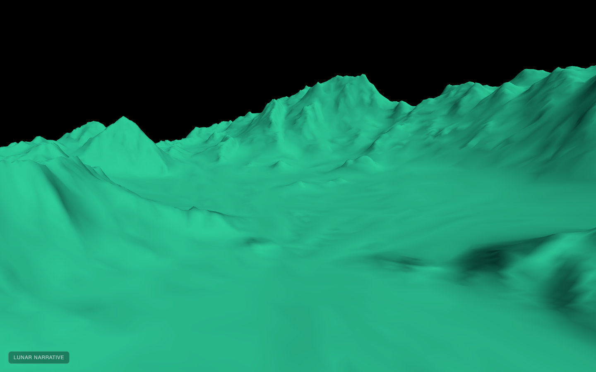

青绿是因为：地形片元最后几行不是给人看的，是给后期看的。它把四个通道分别编码成：

```glsl
gl_FragColor = vec4(col, 0.0);
gl_FragColor.g = v_depth;                    // g = 线性深度
gl_FragColor.b = 1.0;
gl_FragColor.r *= u_sceneRatio;              // r = 照明，随场景淡入
gl_FragColor.g -= blueNoise.z * 0.004;       // 深度抖动，消 8bit 带阶
gl_FragColor.b = linearStep(15.0, 66.0, v_worldPosition.z);
gl_FragColor.a = spec * shadow;
```

全场只有四个通道，每个都有明确分工。r 是照明，后期的灰度预通道只读它，泛光也只认它；g 是线性深度，雾靠它；b 是远景标记，`linearStep(15, 66, z)`，雾片靠它统一衰减，`b = 1` 是"远处"；a 是高光遮罩，直接当泛光范围用，`spec * shadow`。

后期链不需要深度图、不需要法线图，只要这一张图。这是整套效果能跑得动的地基。

地形本身只有 13872 个顶点、80238 个索引，能撑起山脊的大轮廓（y 从 -1.02 到 19.45），但撑不起碎石和接触阴影。所以细节全在 `terrain_shadow_light_height.webp` 里，片元里拆开：

```glsl
vec3 mixedTexture = texture2D(u_texture, v_uv).rgb;
float shadow = mixedTexture.r;
float light  = clamp(mixedTexture.g, 0.1, 1.0);

float faceDirection = gl_FrontFacing ? 1.0 : -1.0;
vec3 normal = normalize(v_viewNormal) * faceDirection;
normal = perturbNormalArb(-v_viewPosition, normal, dHdxy_fwd(), faceDirection);
vec3 N = inverseTransformDirection(normal, viewMatrix);
```

`dHdxy_fwd()` 采样高度图在屏幕 x/y 方向的差值，再用 three 的 `perturbNormalArb` 同款实现扰动法线。于是几何负责"大山脊"，贴图负责"石头缝"：远处的大形来自顶点，脚下的颗粒、起伏和掠射高光，全是从 b 通道"猜"出来的。

三个东西别删。`frustumCulled = false`：地形几乎铺满视野，剔除省不下什么，但某些贴地角度会因包围球判断把整片地面剔掉，表现为"一低头地面没了"。`side: THREE.DoubleSide`：坑壁从内部看是背面，单面渲染会出现黑洞。`extensions: { derivatives: true }`：`dFdx/dFdy` 扰法线要用它，WebGL2 里通常没事，但别赌。

---

## 6. 接上后期，画面第一次正常

上一节那片青绿先别慌。它本来就是给后期看的中间数据，过六个 pass 之后才是月面，地平线也开始发光。

先拷文件：

```bash
cp /path/to/lunar-narrative/src/effects/GoalBloom.js   ./src/effects/
cp /path/to/lunar-narrative/src/effects/FinalPass.js   ./src/effects/
cp /path/to/lunar-narrative/src/effects/SmaaPass.js    ./src/effects/
cp /path/to/lunar-narrative/src/effects/FsrPass.js     ./src/effects/
```

`PreEfxPass` 这个类（1314 行起，以及它依赖的 `MOTION_BLUR_FRAG` / `BLUR9_FRAG`）也整段拷，第 12 步会用到后者。调色用的 `EFX_FRAG` 同样搜名字拷过来，就在 `PRE_EFX_FRAG` 后面不远。

然后在 `mount` 里、各系统构建完之后，组装后期链：

```js
import { EffectComposer } from 'three/examples/jsm/postprocessing/EffectComposer.js'
import { RenderPass } from 'three/examples/jsm/postprocessing/RenderPass.js'
import { ShaderPass } from 'three/examples/jsm/postprocessing/ShaderPass.js'
import { Pass, FullScreenQuad } from 'three/examples/jsm/postprocessing/Pass.js'
import { GoalBloomPass } from './GoalBloom.js'
import { FinalPass } from './FinalPass.js'
import { SmaaPass } from './SmaaPass.js'
import { FsrPass } from './FsrPass.js'

// —— 后期链：顺序就是命 ——
const composer = new EffectComposer(renderer)
composer.setSize(window.innerWidth, window.innerHeight)
composer.addPass(new RenderPass(this.scene, this.camera))

// 1. 预通道：只留 r（灰度）和 a（泛光遮罩）
this.preBaseMat = new THREE.ShaderMaterial({
  uniforms: { u_texture: { value: null } },
  vertexShader: FULLSCREEN_VERT,
  fragmentShader: PRE_EFX_FRAG,
  depthTest: false,
  depthWrite: false
})
this.preEfxPass = new PreEfxPass(this.preBaseMat)
composer.addPass(this.preEfxPass)

// 2. 泛光（FFT 卷积 + halo）
this.bloom = new GoalBloomPass()
this.bloom.setSize(composer.renderTarget1.width, composer.renderTarget1.height)
this.bloom.amount = 3
this.bloom.renderToScreen = false
composer.addPass(this.bloom)

// 3. 调色：colorBurn / colorDodge
this.efxPass = new ShaderPass({
  uniforms: {
    u_texture: { value: null },
    u_colorBurn: { value: new THREE.Color('#00f0ff') },
    u_colorBurnAlpha: { value: 0.15 },
    u_colorDodge: { value: new THREE.Color('#005aff') },
    u_colorDodgeAlpha: { value: 0.12 }
  },
  vertexShader: FULLSCREEN_VERT,
  fragmentShader: EFX_FRAG
})
this.efxPass.textureID = 'u_texture'
this.efxPass.renderToScreen = true
this.efxPass.material.blending = THREE.NoBlending
this.efxPass.material.depthTest = false
this.efxPass.material.depthWrite = false
composer.addPass(this.efxPass)

// 4. 暗角 / dither（默认关）
this.finalPass = new FinalPass()
this.finalPass.enabled = false
composer.addPass(this.finalPass)

// 5. SMAA 抗锯齿（常驻）
this.smaaPass = new SmaaPass()
this.smaaPass.enabled = true
composer.addPass(this.smaaPass)

// 6. FSR 超分（默认关）
this.fsrPass = new FsrPass()
this.fsrPass.enabled = false
composer.addPass(this.fsrPass)

this.composer = composer
```

再改两处。`resize()` 里加 `this.composer?.setSize(w, h)`。

`_renderFrame` 末尾，把 `this.renderer.render(this.scene, this.camera)` 换成：

```js
this.preEfxPass.use(this.preBaseMat)

// 泛光强度跟着叙事走：3 → 1.5 → 10
let bloomAmount = 3
bloomAmount = fit(introRatio, 0.1, 0.85, bloomAmount, 1.5)
bloomAmount = fit(introRatio, 0.85, 1, bloomAmount, 10)
this.bloom.amount = bloomAmount
this.bloom.radius = 0
this.bloom.saturation = 1
this.bloom.highPassMultiplier = 1
this.bloom.haloWidth = 0.6
this.bloom.haloRGBShift = 0.02
this.bloom.haloStrength = fit(introRatio, 0.1, 0.4, 0.08, 0.15)
this.bloom.haloMaskInner = 0.3
this.bloom.haloMaskOuter = 0.5

this.composer.render(dt)
```

月面第一次正常。远处有青蓝色的雾霭，山脊边缘有一层很淡的辉光，调色让暗部偏冷青、亮部偏蓝。到这儿你会第一次觉得"像那么回事了"。

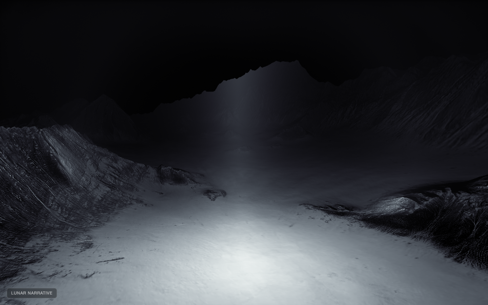

如果画面还是一张绿图：检查 `this.preEfxPass.use(this.preBaseMat)` 有没有每帧调用。`PreEfxPass` 默认用的是你构造它时传的那张材质，换材质之后必须重新 `use`。

六个 pass 的分工和顺序（括号里是原站的 renderOrder，照抄）：

```
场景 RenderPass
  → PreEfx (5)    灰度 / 运动模糊（二选一）
  → Bloom (10)    FFT 卷积泛光 + halo
  → Efx (20)      colorBurn / colorDodge 双色调
  → Final (30)    暗角 / dither（默认关闭）
  → Smaa (500)    SMAA 抗锯齿
  → Fsr (2000)    FSR 超分（默认关闭）
```

SMAA 必须排在 Efx 后面。它需要显示空间（sRGB）的颜色做边缘检测；放在 Efx 之前，它会在灰度图上找边缘，方向全是错的，结果就是锯齿没消，反而多了一层毛边。

泛光 3 → 1.5 → 10 也不是审美，是叙事。入场要梦幻，落定要克制，转场要过曝。三段全由 `introRatio` 驱动，没有关键帧。

三个坑。`Efx` 的输入只读 `r`，调色完全没反应的话，先确认场景材质有没有把照明写到 r——地形那步已经写好了，后面每个物体的 shader 都要守这个约定。泛光强度是局部变量 `bloomAmount`，控制台改 `bloom.amount` 会被下一帧覆盖；想关掉泛光，用 `window.__about.bloom.enabled = false`（前提是实例挂到了 window 上，下一段就挂）。还有，别把 `FinalPass` 和 `FsrPass` 的 `enabled` 打开来"看看效果"，除非你打算重调曝光，它们是给原站不同场景准备的，这里默认关。

---

## 7. 光柱：一次 `atan` 换掉几十次采样

这一节的代码最少，原理最值得看。月面上射出几道光柱，随滚动由细变粗；远景有同一束光的背景光晕，接缝看不出来。

先加远景光晕盒。它和地形共用同一套散射公式，所以近处的地面和远处的盒子是同一束光：

```js
_buildHalo() {
  const mat = new THREE.ShaderMaterial({
    uniforms: {
      ...this.shared,
      u_sceneRatio: this.shared.u_sceneRatio
    },
    vertexShader: HALO_VERT,
    fragmentShader: withChunks(HALO_FRAG),
    transparent: false,
    depthWrite: false,
    depthTest: true,
    side: THREE.DoubleSide
  })

  this.haloMesh = new THREE.Mesh(this.bgBoxGeo, mat)
  this.haloMesh.renderOrder = 10
  this.haloMesh.frustumCulled = false
  this.scene.add(this.haloMesh)
}
```

`HALO_VERT` / `HALO_FRAG` 同样从仓库整段拷（搜名字）。`mount` 里 `_buildGround()` 之后调用 `this._buildHalo()`。

接着在 `_renderFrame` 里，`shared` 赋值之后加散射参数和光源漂移：

```js
// 光柱粗细：入场 0..0.2 从细（powInv=2）变粗（0.7），0.7..0.85 再收紧到 0.4
let powInv = fit(introRatio, 0, 0.2, 2, 0.7)
powInv = fit(introRatio, 0.7, 0.85, powInv, 0.4)
this.shared.u_lightScatterPowInv.value = powInv

// 光柱强度：0.7 之后收掉
this.shared.u_lightScatterRatio.value = fit(introRatio, 0.7, 0.85, 1, 0, ease.cubicIn)

// 光源轻微布朗运动：三条不同频率的正弦叠加，看起来没有周期
const t = this._time
this.scatterPos0.set(
  Math.sin(t * 0.31) * 0.35,
  18 + Math.sin(t * 0.23) * 0.4,
  Math.cos(t * 0.27) * 0.35
)
this.scatterPos1.set(
  Math.sin(t * 0.19 + 1.7) * 0.28,
  Math.sin(t * 0.17) * 0.55,
  Math.cos(t * 0.21 + 2.1) * 0.28
)
```

几道偏蓝的光柱从月面升向天空，入场时很细，滚到 1/5 左右变粗，滚到 70% 之后慢慢收掉。远景的光晕和近处的光柱亮度是连续的，没有"物体边缘突然变干净"的接缝。

画面里那几道光不是体积雾、不是 raymarch、不是后期 god ray，是一个解析积分。标准做法是沿射线步进采样，这里直接给闭式解：

```glsl
float getScatterCoff(vec3 start, vec3 dir, vec3 lightPos, float d) {
  vec3 q = start - lightPos;
  float b = dot(dir, q);
  float c = dot(q, q);
  float t = c - b * b;                 // 到光轴的垂直距离平方
  float s = 1.0 / (2.5 + pow(0.001 + t, 0.8));
  return s * (atan((d + b) * s) - atan(b * s));
}
```

`atan` 那一坨看着唬人，其实就是 `∫ 1/(t + x²) dx` 的积分结果。`t` 是射线到光轴的垂直距离，离光轴越近 `t` 越小、`s` 越大、光柱越亮。一次 `atan` 代替了几十次采样，这是整站性价比最高的一个 shader。

原站的光源不是点，是一条从月面到天空的线段，所以多一步"求线段上离射线最近的点"：

```glsl
vec3 segCenter = (lightPos0 + lightPos1) * 0.5;
vec3 segDir = normalize(lightPos1 - lightPos0);
float s = clamp((a01 * b0 - b1) / max(0.0001, det), -segExtent, segExtent);
vec3 lightPos = segDir * s + segCenter;
float v = getScatterCoff(start, dir, segExtent > 0.0 ? lightPos : lightPos0, d);
return vec2(v, s / segExtent * 0.5 + 0.5);
```

返回值的 y 是"最近点在线段上的归一化位置"，用来让光柱上下两段颜色不同。这套公式被 `#include <getScatter>` 注入到地面、岩石、人物的片元里，所以所有物体共享同一束光，不需要额外的透明几何体。光柱不是"画上去"的，是每个像素自己算出来的。

光柱需要一个"介质"才不显得假，顺手把雾加上。拷 `_buildFog` 方法和 `FOG_VERT` / `FOG_FRAG`，在 `_buildHalo()` 之后调用。雾片是 32 张实例化面片，贴 `fog.png`（r=密度 g=深度偏移），靠 `gl_Position.z = 2*w` 把透明为 0 的片元直接推出裁剪空间。`resize()` 里再加一行 `this.fogCacheRT?.setSize(this.renderer.domElement.width, this.renderer.domElement.height)`。不加这一步也不是不能看，就是远景会"太干净"，光柱像贴在天上。

光柱的亮度没有独立的 alpha 遮罩，泛光只能从 r 通道读到它。想让它更亮，调 `u_lightScatterRatio` 和 `powInv`（以及 `u_lightScatterDivider` 的近远比值），不要把希望寄托在 bloom 上。

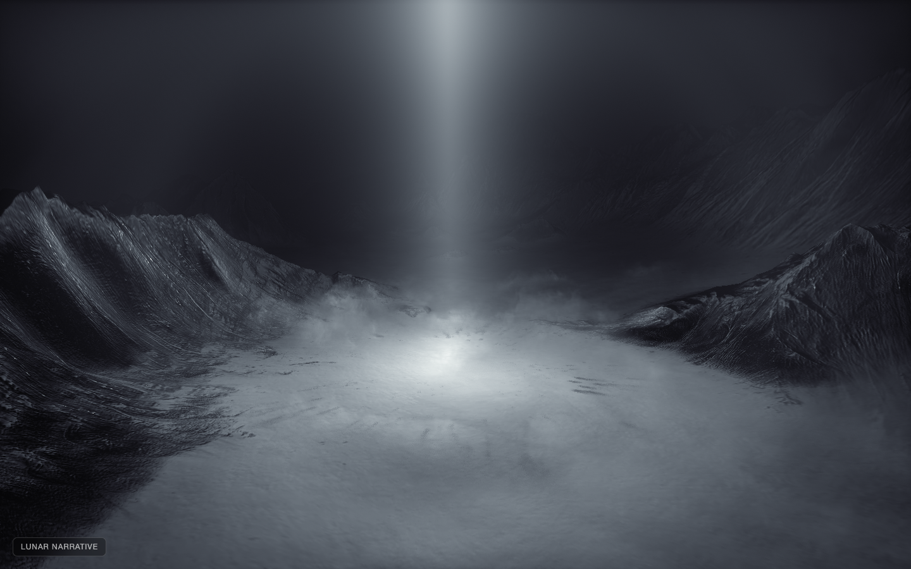

---

## 8. 岩石：把 120 帧动画烤进一张 16×120 的浮点贴图

代码量最大的一节，要有心理准备。做完的效果是月面上长出碎石，翻滚上升，在地面投下软影。

直接拷方法，别手打。四个常量：`ROCK_VERT`（169–349 行）、`ROCK_FRAG`（350–416 行）、`LIGHT_SHADOW_FRAG`（80–89 行）、`GROUND_SHADOW_FRAG`（90–168 行）。五个方法：`_buildLight`（1850）、`_buildRocks`（1942）、`_buildGroundShadow`（1876）、`_renderLightShadow`（2448）、`_updateGroundShadow`（2476）。`_buildRocks` 是 `async`，`mount` 里要 `await`。

`mount` 里的顺序必须是这个，顺序错了会看到黑阴影或者没阴影：

```js
await this._loadAssets()
this._buildLight()          // 1024×2048 光源距离图
this._buildGround()
this._buildHalo()
this._buildFog()
this._buildGroundShadow()   // 依赖 groundMesh，必须在 _buildGround 之后
await this._buildRocks()
// 之后才是人物 / 粒子 / 标题
```

月面上出现四组石头，每组 64 个实例，每个实例被切成 16 块。石头在 0.25 秒内"长"出来，停留 2 秒，再用 4 秒翻滚着飞走，地面上的影子跟着变软、飘散。

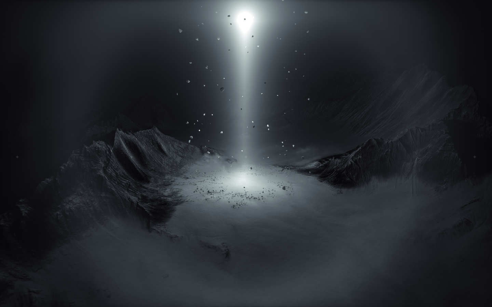

每帧还要喂它时间和尺度，并把岩石投进光源阴影图、把阴影累积到地面：

```js
for (const u of this.rockUniforms || []) {
  u.u_time.value += frozenDt
  u.u_globalTime.value = this._time
  u.u_scale.value = fit(introRatio, 0, 0.2, 0, 1)
}

this._renderLightShadow()    // 岩石 → 1024×2048 距离图
this._updateGroundShadow()   // 8-tap 累积 → 768×768 双缓冲
```

`u_time` 走减速后的 `frozenDt`，所以按住鼠标时岩石会慢下来；`u_globalTime` 走原速，悬浮的细微漂移不会跟着停。

为什么用贴图而不是骨骼：4 种高模 × 64 实例 × 16 块碎片，如果每帧传矩阵，CPU 先累死。烘焙成两张 `16×120` 的 RGBA Float 贴图之后，每帧零 CPU 开销，GPU 自己查表：

```js
const posTex = new THREE.DataTexture(posData, PIECE, FRAMES, THREE.RGBAFormat, THREE.FloatType)
posTex.minFilter = posTex.magFilter = THREE.NearestFilter

const orientTex = new THREE.DataTexture(orient, PIECE, FRAMES, THREE.RGBAFormat, THREE.FloatType)
orientTex.minFilter = orientTex.magFilter = THREE.NearestFilter
```

必须 `NearestFilter`。帧号是整数索引，线性过滤会把相邻两帧混在一起，碎片会"融化"。

顶点着色器里当前帧和下一帧各采一次，手动插值：

```glsl
float frame = linearStep(0.25, 2.25, time) * 119.0;
float frameFloor = floor(frame);
float frameCeil = min(frameFloor + 1.0, 119.0);
float frameFract = frame - frameFloor;

vec4 simUvs = (vec3(piece, frameFloor, frameCeil).xyxz + 0.5) / u_animationTextureSize.xyxy;
vec4 posRand1 = texture2D(u_posRandTexture, simUvs.xy);
vec4 orient1 = texture2D(u_orientTexture, simUvs.xy);
vec4 posRand2 = texture2D(u_posRandTexture, simUvs.zw);
vec4 orient2 = texture2D(u_orientTexture, simUvs.zw);

vec3 pos1 = qrotate(orient1, position) * pieceScale + posRand1.xyz;
vec3 pos2 = qrotate(orient2, position) * pieceScale + posRand2.xyz;
```

整个生命周期也是纯函数，6.25 秒一轮：

```glsl
float duration = 0.25 + 2.0 + 4.0;
float time = duration * instanceRands.x + u_time;
float cycle = floor(time / duration);
time = time - duration * cycle;

float flyUpRatio = pow(linearStep(2.25, 6.25, time), 1.5);
float appearRatio = linearStep(0.0, 0.25, time - instanceRands.y);
```

0.25 秒长出、2 秒停留、4 秒飞走，相位由 `instanceRands.x` 错开。看起来是乱的，其实是同一段循环。

阴影那边有个小魔术：岩石的阴影不是再画一遍高模，而是把同一份顶点着色器加上 `IS_SHADOW` define，直接写裁剪空间：

```glsl
#ifdef IS_SHADOW
  vec3 center = instanceOffset + origin - u_lightPosition;
  pos -= u_lightPosition;
  v_distToLight = length(pos) / u_lightShadowMaxDistance;
  if (center.y > 0.0) { pos.y = max(0.001, pos.y); } else { pos.y = min(-0.001, pos.y); }
  gl_Position = vec4(getLightUv(pos) * 2.0 - 1.0, 1.0 - v_distToLight, 1.0);
#else
  // 正常渲染：法线 + 深度
#endif
```

`getLightUv` 把方向映射成"上半球 / 下半球"两张极坐标图，1024×2048 一张贴图覆盖全向。它存的不是深度，是到光源的距离，所以地面那步可以直接拿 `selfDist - dist` 做比较。碎片在阴影 pass 里还会放大 1.5 倍（`pieceScale *= 1.5`），让软阴影更明显——物理上错，画面上对。

地面阴影是 8-tap 加时间累积，核心就一行：

```js
gl_FragColor = vec4(mix(prevShadowMask, shadowMask, shadowMask > prevShadowMask ? 0.5 : 0.2));
```

变暗用 0.5，变亮用 0.2。岩石飘过来时阴影迅速出现，飘走时慢慢消退。物理上不严谨，观感上非常对。这一行比任何降噪算法都便宜。

几个数值。阴影图是 768×768，覆盖半径 12，采样时局部坐标再乘 0.0425，差不多"一张 768 的图覆盖 24 个单位见方的地面"。0.0425 改大，阴影会硬得像贴纸；改小，会糊成一片。`_buildGroundShadow` 必须在 `_buildGround` 之后调用，因为它要把 `u_groundShadowTexture` 换成真正的双缓冲；顺序反了的表现是地面永远没有影子，但控制台不报错。岩石的阴影网格用 `rock_*_low.buf`，不要用高模，高模只多花顶点，画面上看不出来。

---

## 9. 宇航员：54 根骨头塞进 uniform

陨坑边站着一个会呼吸的人；按住鼠标，他和岩石一起进入子弹时间。

拷 `PERSON_VERT`、`PERSON_FRAG`、`PERSON_SHADOW_VERT`、`PERSON_SHADOW_FRAG`（417–565 行），以及 `_buildPerson`（2627）、`_updatePerson`（2796）两个方法。`_buildPerson` 是 `async`，在 `_buildRocks` 之后 `await`；`_updatePerson(frozenDt)` 每帧在 `composer.render` 之前调用。

陨坑边出现一个宇航员，动作很慢，像在月面上呼吸。按住鼠标，他的速度降到 10%，而画面整体的漂移不变。

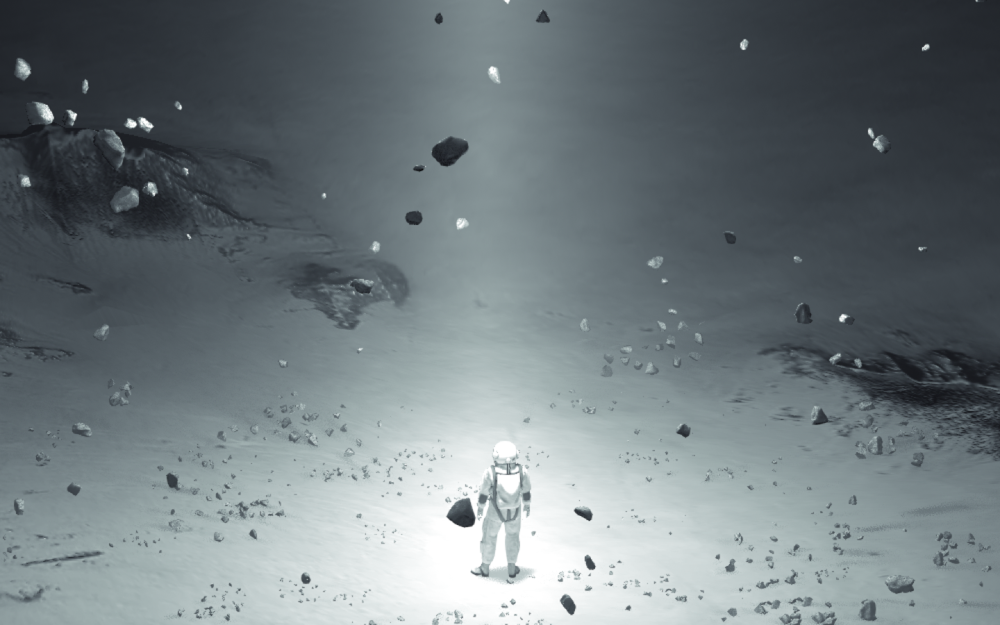

不用 `SkinnedMesh`，是因为骨架只有 54 根，每根只要位置加四元数，一共 54×7 个 float，塞进 uniform 数组完全够：

```glsl
attribute vec2 boneIndices;
attribute vec2 boneWeights;
uniform vec3 u_bonePoses[BONE_COUNT];
uniform vec4 u_boneOrients[BONE_COUNT];

void main() {
  vec3 pos = vec3(0.0);
  vec3 nor = vec3(0.0);

  vec3 bonePos = u_bonePoses[int(boneIndices.x)];
  vec4 boneOrient = u_boneOrients[int(boneIndices.x)];
  pos += (qrotate(boneOrient, position) + bonePos) * boneWeights.x;
  nor += qrotate(boneOrient, normal) * boneWeights.x;

  bonePos = u_bonePoses[int(boneIndices.y)];
  boneOrient = u_boneOrients[int(boneIndices.y)];
  pos += (qrotate(boneOrient, position) + bonePos) * boneWeights.y;
  nor += qrotate(boneOrient, normal) * boneWeights.y;
}
```

每帧 CPU 侧做的事很朴素：读 `person_idle.buf` 的两帧骨骼数据，位置 `lerp`、四元数 `slerp`，写进 uniform。4590 个顶点、54 根骨头、85 帧 idle、60fps 烘焙，时间再乘 0.5，开销小到可以忽略。

好处是完全可控。想让人物跟着镜头节奏慢下来，只要给 `_updatePerson(frozenDt)` 传减速后的 dt。用 `SkinnedMesh` 也能做，但你要去改 `mixer.timeScale`，还要处理 clip 的循环点。

人物投影是一张 1.5×1.5 的面片，贴 `ground_person_shadow.webp`。混合模式这里有个坑：

```js
blending: THREE.CustomBlending,
blendEquation: THREE.AddEquation,
blendSrc: THREE.ZeroFactor,
blendDst: THREE.SrcColorFactor,
```

也就是 `dst * src`。原站在 r158 用 `THREE.MultiplyBlending`，升级到 r187 后行为变了；不显式写的话，人物脚下的影子会变成一块白斑。

人物材质和地形一样，要把照明写到 r、深度写到 g，否则后期看不到他。阴影面片不要开 `depthWrite`，否则会在地面上切出一块方形的"洞"。

---

## 10. 24576 颗尘埃，和一张 64³ 的光照场

这一段几乎全在 GPU 里跑，JS 侧只有接线。粒子星尘铺开、呼吸、边缘发光；它们看起来被一束看不见的光照亮，但没有任何逐粒子光源计算。

拷文件：

```bash
cp /path/to/lunar-narrative/src/effects/AboutHeroParticles.js ./src/effects/
```

加一个十行的接线方法，在 `_buildPerson()` 之后 `await`：

```js
async _buildParticles() {
  this.particles = new AboutHeroParticles({
    renderer: this.renderer,
    scene: this.scene,
    shared: this.shared,
    withChunks
  })
  await this.particles.load()
}
```

`_renderFrame` 里，粒子更新要放在岩石 uniform 更新之前，因为它会给 `u_noiseStableFactor` 写值：

```js
// 必须在岩石之前：粒子 sim 会写 u_noiseStableFactor
this.particles?.update(dt, introRatio, 0, frozenDt)

// 后面才是第 8 步那段岩石 uniform + 阴影渲染
```

一层很细的星尘从光源附近散开，缓慢自旋，边缘带一点冷光；滚动到远景时，它们和雾片、光柱叠在一起。

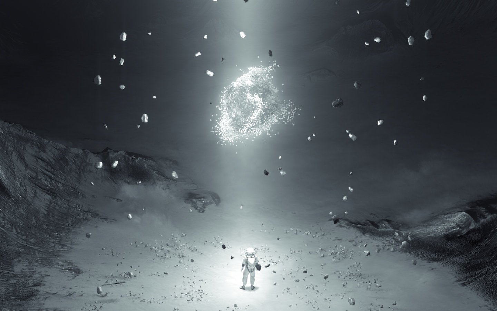

粒子的位置和生命不存在 JS 数组里，存在一张 `128×192` 的浮点纹理里，RGBA = `xyz + life`。每帧跑一次全屏 shader，读上一帧、写下一帧。24576 个粒子，CPU 一次循环都不用写。

生命耗尽就重生：`posLife.w -= (0.5 + u_noiseStableFactor) * u_introDeltaTime`，小于 0 就回到默认分布，生命 +1。这个 `1.0` 不是秒，是归一化寿命，配合衰减速度决定粒子多久重生一次。

只有两个力：绕光源自旋（`cross(axis, toLight)`）加 curl noise 湍流。curl 是两次 simplex 噪声导数域求旋度，保证流场无散度，粒子不会莫名其妙往一个点挤。

渲染是实例化球体，不是 `Points`。`sphere_l/m/s/xs` 四档，按入场进度切：

```js
const early = introRatio < 0.3
const mid = !early && introRatio < 0.7
const neIdx = early ? 1 : mid ? 2 : 3  // 普通组：m → s → xs
const eIdx  = early ? 0 : mid ? 1 : 3  // 发光组：l → m → xs
```

越往后粒子整体越小、越密，粗一级的球在那个尺度上根本看不出来。

光照场是 64³ 的体素按 z 切片，每片 64×64，8 列 8 行拼成一张 512×512 的图：

```js
const cellCount = this.GRID_COUNT.x * this.GRID_COUNT.y * this.GRID_COUNT.z // 262144
const cols = Math.ceil(Math.sqrt(cellCount) / this.GRID_COUNT.x)             // 8
const rows = Math.ceil(this.GRID_COUNT.z / cols)                             // 8
const lfSize = this.GRID_COUNT.x * cols                                      // 512
```

每帧三步：清空"本帧粒子点"图集 → 所有粒子用 `MaxEquation` 画进去 → 和上一帧做时间累积 + 跨 slice 模糊。采样时先算体素坐标，再映射到"第几片、片内哪个像素"，最后在相邻两片之间 `mix`。

累积不是简单 `lerp`：先沿 z 做 3 邻域加权（`-1 / 0 / +1`，权重 `.25 / .5 / .25`），再按 `mix(0.15, 0.08, prev.r)` 向上一帧收敛。亮的地方收敛快、暗的地方收敛慢，光就有"余晖"，不会跟着粒子一闪一闪。

用 8bit，是因为这里存的不是真实辐照度，只是"这附近有没有光"的软权重。三张 512² 的 8bit 图也就 3MB 左右，比真开一个 64³ 浮点体积便宜一个量级。

第 5 坑的另一半也在这儿：岩石的动画贴图必须 `NearestFilter`，光照场反过来，它存的是连续的亮度权重，代码里故意用 `LinearFilter`，让相邻体素平滑过渡。换成 `Nearest` 会看到一格一格的方块光。索引型纹理用 Nearest、权重型纹理用 Linear，别把这条记反。

---

## 11. 标题：DOM 是锚点，WebGL 只是笔

首屏巨大的「VEIL 0.0」从下往上逐字弹出；一开始滚动就整块淡出，避免镜头已经推到陨坑时大字母还压在画面上。

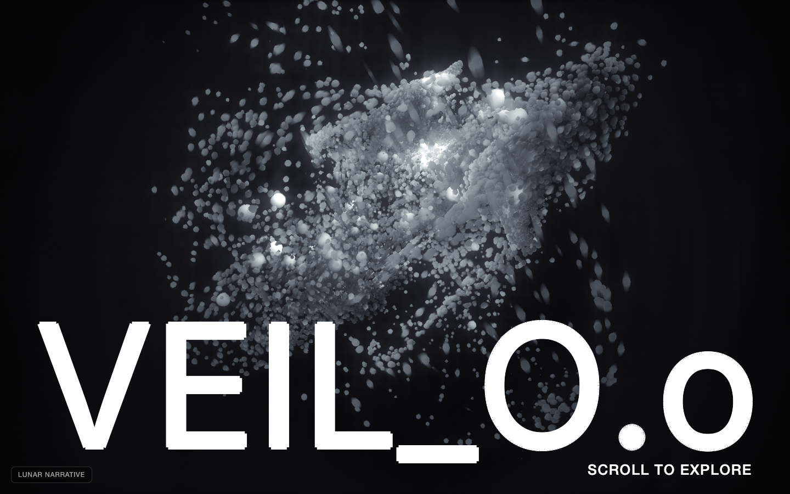

拷 `LOGO_VERT`、`LOGO_FRAG`（1216–1313 行），以及 `_buildLogo`（2531）、`_updateLogo`（3164）。`_buildLogo` 里读 `logo_text.buf`，只有 8 个字形；`AboutView.vue` 里那个 `logoEl` 就是锚点，别删。

`mount` 里在粒子之后 `await this._buildLogo()`，构造函数里补一行 `this._logoHide = 0`（退场比例，不初始化会算出 `NaN`，标题直接消失）。`_renderFrame` 的最后，在 `composer.render(dt)` 之后单独渲染标题：

```js
this._logoHide = saturate(this._logoHide + dt * (introRatio < 0.05 ? -1 : 1))
this._updateLogo(0)

if (this.logoMesh?.visible) {
  this.renderer.setRenderTarget(null)
  this.renderer.render(this.logoScene, this.camera)
}
```

标题从下往上弹入，每个字有轻微过冲；滚动一段之后，整行字开始向右下角收拢、变小、淡出。

它每帧读一次 DOM 的 `getBoundingClientRect()`（`el` 就是 `mount` 时传进来的 `this.els.logoEl`），把标题钉在 DOM 锚点上：

```js
const r = el.getBoundingClientRect()
U.u_domXY.value.set(r.left, r.top)
U.u_domWH.value.set(r.width, r.height)
```

顶点着色器里做三件事：

```glsl
// 局部 [0,1]² → DOM rect（DOM 的 y 向下）
vec2 mainPx = u_domXY + vec2(aspectCorrectedPos.x, 1.0 - aspectCorrectedPos.y) * u_domWH;

// 逐字错峰出现（x 越大越晚），easeOutBack 制造过冲
float show = easeOutBack(linearStep(0.0, 1.0, u_showRatio * 2.2 - aspectCorrectedPos.x - aspectCorrectedPos.y * 0.2));
mainPx.y += (1.0 - show) * (u_domWH.y + min(u_domWH.y * 1.1, 100.0));

// 退场目标：左下角小 logo，按字序错开
float charShift = char / max(1.0, u_charMax) * 0.08;
vec2 toPx = u_toDomXY + vec2(aspectCorrectedPos.x - charShift, 1.0 - aspectCorrectedPos.y) * u_toDomWH;

// morph 进度，末端淡出
float hide = cubicInOut(linearStep(0.0, 1.0, u_hideRatio * 2.2 - aspectCorrectedPos.x - pow(aspectCorrectedPos.y, 1.0 + u_hideRatio) * 0.2));
vec2 px = mix(mainPx, toPx, hide);
v_fade = 1.0 - smoothstep(0.82, 1.0, hide);

gl_Position = vec4(px.x / u_resolution.x * 2.0 - 1.0, 1.0 - px.y / u_resolution.y * 2.0, 0.0, 1.0);
```

用 DOM 做锚点的好处：响应式布局、字号、安全区全交给 CSS，WebGL 只负责"把字画在 rect 里"。窗口一变，下一帧自动对齐，不需要在 JS 里算断点。

抗锯齿不用 MSAA，用 `fwidth` 算一个像素的裙边宽度：

```glsl
float alpha = smoothstep(0.0, 0.0 + fwidth(v_dist), v_dist) * v_fade;
if (alpha < 0.002) discard;
```

标题是在后期链跑完之后单独再渲一遍到屏幕的，它不参与泛光、不参与调色。所以它永远干净锐利——这是故意的。塞回主场景，它会立刻被 bloom 糊成一团，并且颜色被 efx 拉偏。

---

## 12. 总装，顺序就是命

零件都在文件里了。最后按正确顺序装起来，顺便补上第 6 步没接的运动模糊。

`mount` 的完整顺序，照这个抄，不要按感觉排：

```js
renderer / scene / camera / shared     // 基础设施
await this._loadAssets()               // .buf + 贴图
this._buildLight()                     // 光源距离图
this._buildGround()                    // 地形
this._buildHalo()                      // 远景光晕
this._buildFog()                       // 雾片
this._buildGroundShadow()              // 地面软阴影双缓冲
await this._buildRocks()               // 岩石
await this._buildPerson()              // 宇航员
await this._buildParticles()           // 粒子 + 光照场
await this._buildLogo()                // 标题
/* 后期链：RenderPass → PreEfx → Bloom → Efx → Final → Smaa → Fsr */
/* 事件监听 → resize → RAF */
```

渲染顺序。透明物体靠 `renderOrder` 手工排，不依赖 three 的自动排序：

| 物体 | renderOrder |
| --- | --- |
| 地形 | 0 |
| 粒子 | 5 |
| 岩石 | 5 |
| 光晕 / 标题 | 10 |
| 雾 | 20 |

每帧的更新顺序，这一段比 shader 更容易写错：

```
dt / freezeRatio
→ u / 两个比例
→ 相机（位置 + 朝向 + FOV）
→ shared 赋值
→ 光柱参数 + 光源漂移
→ 泛光参数
→ 选 PreEfx 材质
→ 粒子 update（写 noiseStableFactor）
→ 运动模糊速度图
→ 岩石 uniform
→ 岩石投进光源阴影图
→ 地面阴影累积
→ 人物骨骼
→ composer.render
→ 标题单独渲染
→ DOM 层
```

粒子必须早于岩石，因为 `u_noiseStableFactor` 是粒子 sim 每帧写的；岩石如果在前面读，会慢一帧。人物必须在 `composer.render` 之前更新，否则骨骼会滞后。

补运动模糊。第 6 步只用了灰度预通道，现在把 `PreEfx` 的另一个人格接上。先建 1/4 分辨率的速度图和清屏材质：

```js
this.motionRT = new THREE.WebGLRenderTarget(1, 1, {
  minFilter: THREE.LinearFilter,
  magFilter: THREE.LinearFilter,
  depthBuffer: true,
  stencilBuffer: false
})
this.motionTmpRT = new THREE.WebGLRenderTarget(1, 1, {
  minFilter: THREE.LinearFilter,
  magFilter: THREE.LinearFilter,
  depthBuffer: false,
  stencilBuffer: false
})

this.blurMat = new THREE.ShaderMaterial({
  uniforms: { u_texture: { value: null }, u_delta: { value: new THREE.Vector2() } },
  vertexShader: FULLSCREEN_VERT,
  fragmentShader: BLUR9_FRAG,
  depthTest: false,
  depthWrite: false
})

this.preMotionMat = new THREE.ShaderMaterial({
  uniforms: {
    u_texture: { value: null },
    u_motionTexture: { value: this.motionRT.texture },
    u_blurRatio: { value: 0 }
  },
  vertexShader: FULLSCREEN_VERT,
  fragmentShader: withChunks(MOTION_BLUR_FRAG),
  depthTest: false,
  depthWrite: false
})

this._motionClearMat = new THREE.ShaderMaterial({
  uniforms: {},
  vertexShader: FULLSCREEN_VERT,
  fragmentShader: 'varying vec2 v_uv; void main() { gl_FragColor = vec4(0.5, 0.5, 0.5, 0.0); }',
  depthTest: false,
  depthWrite: false
})

// 速度清屏 / 模糊 / 拷贝共用的全屏面片
this._fsQuad = new THREE.Mesh(new THREE.PlaneGeometry(2, 2), null)
this._fsQuad.frustumCulled = false
this._fsScene = new THREE.Scene()
this._fsScene.add(this._fsQuad)
```

`_renderMotionBlur` 整个方法从仓库拷（搜名字），然后在 `_renderFrame` 里加：

```js
let motionRatio = fit(introRatio, 0, 0.1, 1, 1.5)
motionRatio = fit(introRatio, 0.1, 0.15, motionRatio, 0)

if (motionRatio > 0) {
  this.preEfxPass.use(this.preMotionMat)
  this.preMotionMat.uniforms.u_blurRatio.value = motionRatio
} else {
  this.preEfxPass.use(this.preBaseMat)
}

if (motionRatio > 0 && this.particles) this._renderMotionBlur(vw / Math.max(1, H))
```

`motionRatio` 的峰值是 1.5，不是 1——入场那一下故意糊过头，落定之后才收回 0。

从顶部往下滚，画面先是黑的，然后淡入；镜头俯冲时带一点运动模糊；落定后模糊消失、泛光收紧；继续滚，光柱收掉、岩石飞走、人还在；再滚，默认 track 就到底了，画面停在陨坑和宇航员。一条镜头，没有剪辑点。

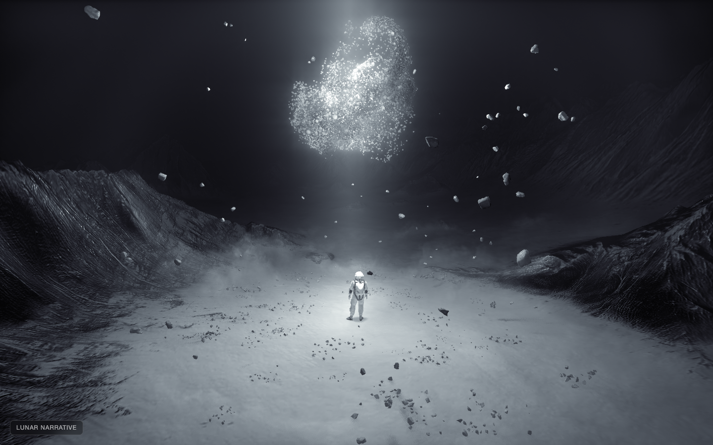

这里还藏着一个非常阴间的坑。速度图的中性值必须是 0.5，代表"没动"。但你不能用 `setClearColor(0.5)`，因为 three 的色彩管理会把它转成线性空间的 0.216，结果整屏都在"微微运动"。所以上面那张 `_motionClearMat` 直接用 shader 写 `gl_FragColor = vec4(0.5, 0.5, 0.5, 0.0)` 来清屏。一行 shader 解决色彩空间问题，比去关 `outputColorSpace` 安全得多。

---

## 13. 验收、性能，和六个会咬人的坑

验收清单：滚到底不掉帧；按住鼠标全体慢放；切标签页回来粒子不穿模；窗口拉窄，镜头构图不散；HMR 改一行不会出现双倍转速。

能稳住帧率，靠的不是"优化技巧"，是一串很清醒的取舍：

| 手段 | 数字 | 换来了什么 |
| --- | --- | --- |
| 像素比封顶 | `min(dpr, 2)` | 4K 屏不炸显存，肉眼几乎无差 |
| dt 上限 | 50ms | 切标签页回来粒子不穿模 |
| 速度图 | 1/4 分辨率 | 运动模糊本来就是糊的 |
| 光照场 | 8bit + 512² × 3 张 | 262144 个体素只占几 MB，还能线性过滤 |
| 地面阴影 | 768² ping-pong + 8-tap | 比 2048 shadow map 便宜，还更软 |
| 岩石阴影 | 低模 + `IS_SHADOW` 分支 | 只多一次顶点绘制 |
| 粒子 LOD | 4 档球体 | 远处用最低面数的球，看不出来 |
| 雾片剔除 | `gl_Position.z = 2*w` | 透明为 0 的片元直接不进光栅化 |
| 几何共享 | 所有材质共享 `getScatter` / `getBlueNoise` chunk | 少编译很多次 shader |
| 后期 pass | Final / Fsr 默认 `enabled=false` | 不用就不编译 |

还有个隐性的：整个 scene 的渲染顺序被手工排过（第 12 步那张表）。省下来的每一次排序都是稳帧率。

六个坑，按疼的程度排序：

1. **`setClearColor(0.5)` 不是 0.5**。three 会把颜色转到线性空间，0.5 变成 0.216。所有"用清屏色当中性值"的地方都会错。解法是用全屏材质写 `gl_FragColor`，绕开色彩管理。
2. **有符号整型反量化不能除以 MAX**。`(raw - min) / (max - min)`，不是 `raw / 32767`。写错的表现是"模型一半亮一半黑，自阴影全乱"，看起来像光照 bug。
3. **`subarray` 的对齐陷阱**。payload 没有 padding，`offset` 不是 4 的倍数时 `new Float32Array(subarray)` 会抛 `RangeError`。`slice()` 拷一份。
4. **r187 的 `MultiplyBlending`**。人物投影必须显式写 `CustomBlending + AddEquation + ZeroFactor + SrcColorFactor`，否则影子变白斑。
5. **Index 用 Nearest，权重用 Linear**。岩石动画帧是索引，线性过滤会融化；光照场是连续权重，最近邻会出方块。
6. **Vue 里异步 `mount` 的竞态**。`AboutView.vue` 的 `onMounted` 没有 `await`——`mount()` 的 `then/catch` 里只调 `markPageReady`，不再碰实例，所以 `onBeforeUnmount` 的 `dispose()` 不会和未完成的加载打架。如果你把它改成 `await mount()` 的写法，组件可能在 await 期间卸载，`dispose` 先跑、`mount` 再往已销毁的 renderer 里塞东西——那时就得加 `disposed` 标记防御了。

三个立刻能动手改的旋钮：

| 想改什么 | 改哪 |
| --- | --- |
| 关掉泛光 | `window.__about.bloom.enabled = false`（改 `amount` 会被下一帧覆盖） |
| 粒子密度 | `AboutHeroParticles.js` 的 `SIM_W / SIM_H`；光照场是独立的 `GRID_COUNT`，不用跟着改 |
| 光柱粗细 | `_renderFrame` 里 `powInv` 的两个 `fit`，把 0.7 改成 0.4 会更粗 |

---

## 14. 最后

走到这里，你手里已经有一条能滚的月面长镜头了。

回头看，真正值得学的不是某个 shader，是它的组织方式：一个滚动值切成几个互不干扰的进度（相机 / 入场）；一张四通道图，把照明、深度、远景、泛光遮罩全打包；一套共享 chunk，让所有材质用同一束光；一个统一的 `dispose()`，让整个体验可以随时装进任何框架。

Vue 在这里真的只是外壳。换成 React、Svelte，甚至一个 20 行的 `document.querySelector`，Three 那部分一行都不用改。

让画面成立的，是那些"不物理但好看"的选择：阴影出现快消失慢、碎片阴影放大 1.5 倍、泛光在转场时故意过曝、标题用 DOM 当锚点。渲染是技术，叙事是取舍。

工程在 `lunar-narrative` 里，注释比这篇文章还密。哪一步跑不起来，先对照第 13 步的坑，再顺着注释找。大多数问题都不是数学，是顺序。